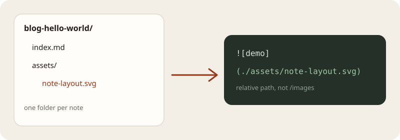

这是 [mzleman.github.io](https://mzleman.github.io/) 的第一篇说明。站点用来放短笔记：首页是最新几篇和可搜索归档，点进去就是一篇 Markdown。

## 一篇笔记一个目录

每篇笔记占 `src/content/blog/` 下的一个文件夹，文件名会变成网址里的路径。例如这篇是：

```text
src/content/blog/blog-hello-world/
  index.md
  assets/
    note-layout.svg
```

线上地址是 `/blog/blog-hello-world`。正文只写在 `index.md` 里。

## 开头的 YAML

`index.md` 顶部用 `---` 包住字段，注意列表项要缩进：

```yaml
---
title: Hello World：怎么写一篇笔记
description: 一句话摘要，会出现在首页列表里。
date: 2026-11-04
tags:
  - blog
  - markdown
draft: false
---
```

`draft: true` 的笔记不会出现在首页和归档里。

## 图片放在相对的 assets 目录

图片、示意图不要放到站点根目录，也不要用 `images`。放到**这篇笔记旁边的** `assets/`，用相对路径引用：

```md

```

Astro 和编辑器预览都能找到 `./assets/...`。下面这张就是按这个规则放进去的演示图，点击可以放大：


## 链接

- 站外：`[GitHub](https://github.com/mzleman)`
- 站内笔记：`[这篇说明](/blog/blog-hello-world)`
- 本地资源：只写相对路径，例如 `./assets/note-layout.svg`

写新笔记时复制 `blog-hello-world` 这一套目录即可：改文件夹名、改 `index.md`、把配图丢进同级 `assets/`。
