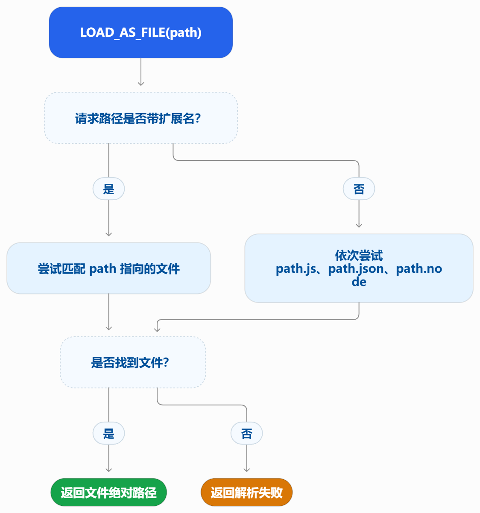
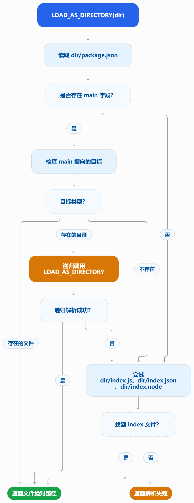
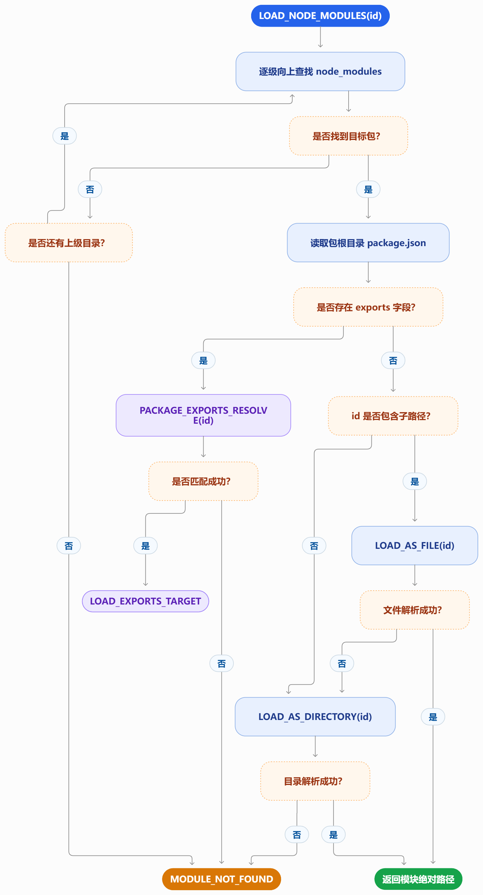
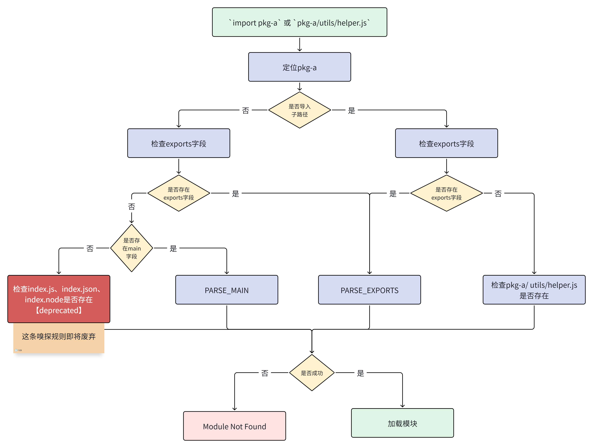
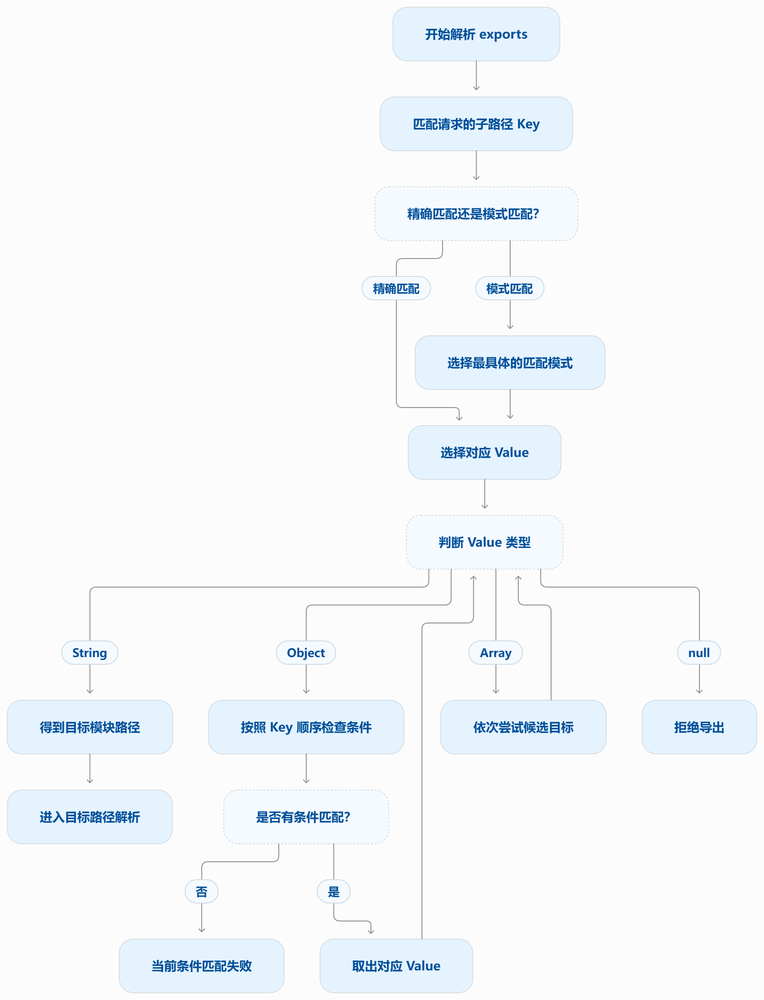

## Package Scope

### 1. 概念

Package Scope（包作用域）是 Node.js 根据 `package.json` 划分出来的一个模块配置作用范围。

Node.js 在判断一个 `.js` 文件应该按照 ESM 还是 CommonJS 加载时，会查找该文件最近的父级 `package.json`，并读取其中的 `type` 字段。

这个 `package.json` 所在的目录，就是对应的 Package Scope 的起点。

需要注意：

- Package 是包的组织概念。
- Package Scope 是 Node.js 用于确定模块配置的作用范围。
- 一个 Package 通常拥有自己的 Package Scope，但 Package Scope 不一定对应一个独立发布到 npm 的包。

### 2. 如何划分 Package Scope

Node.js 以 `package.json` 为依据划分 Package Scope：

1. 一个目录中存在 `package.json`，就可以从该目录开始建立一个 Package Scope。
2. 该 Scope 覆盖当前目录及其子目录。
3. 如果子目录中又出现一个 `package.json`，则从这个子目录开始建立一个新的 Package Scope。
4. 向上查找父级 `package.json` 时，遇到 `node_modules` 目录或文件系统卷根目录就会停止。

例如：

```
project/
├── package.json              # Scope A
├── src/
│   ├── index.js              # 属于 Scope A
│   └── legacy/
│       ├── package.json      # Scope B
│       └── index.js          # 属于 Scope B
└── node_modules/
    └── bar.js                # ⭐没有package scope，只能是否语法检测判断模块化语法，或默认CommonJS
    └── lodash/
        ├── package.json      # Scope C
        └── index.js          # 属于 Scope C
```

这里：

- `project/` 是项目根目录，其 `package.json` 建立 Scope A。
- `src/` 没有自己的 `package.json`，因此属于 Scope A。
- `src/legacy/` 有自己的 `package.json`，因此建立 Scope B。
- `node_modules/lodash/` 有自己的 `package.json`，因此建立 Scope C。
- `node_modules/` 是向上查找 Package Scope 时的边界，不会继续继承 `project/package.json` 的配置。

### 3. Package Scope 的作用

Package Scope 主要影响 Node.js 对模块的解释和解析行为。

**① 决定** `**.js**` **文件的模块类型**

通过 `package.json` 中的 `type` 字段：
```
{
  "type": "module"
}
```

- `"type": "module"`：Scope 内的 `.js` 文件按照 ESM 处理。
- `"type": "commonjs"`：Scope 内的 `.js` 文件按照 CommonJS 处理。
- 没有 `type` 字段：在当前启用语法嗅探的 Node.js 版本中，可能需要进一步进行 Syntax Detection；否则按照 CommonJS 处理。

`.mjs` 始终是 ESM，`.cjs` 始终是 CommonJS，不受 `type` 影响。

**② 决定** `**imports**` **字段的查找范围**

以 `#` 开头的包内部导入标识符，会在当前模块所属 Package Scope 的 `package.json` 中查找 `imports` 映射。

例如：

```
{
  "imports": {
    "#utils": "./src/utils.js"
  }
}
```

在该 Scope 内的模块可以使用：

```
import utils from '#utils';
```

如果子目录有自己的 `package.json`，那么它就属于新的 Scope，查找 `imports` 时也会使用新的 `package.json`。

**③ 参与包自引用（Self-referencing）**

如果 `package.json` 定义了 `name` 和 `exports`，当前包内部的模块可以通过包名引用自身公开的入口：

```
{
  "name": "my-package",
  "exports": {
    ".": "./index.js"
  }
}
import something from 'my-package';
```

### 4. Package Scope 与 npm package 的区别

两者不是同一个概念。

| 对比 | Package | Package Scope |
| --- | --- | --- |
| 核心含义 | 包的组织与分发单元 | 模块配置作用范围 |
| 是否必须发布到 npm | 不需要 | 不涉及发布 |
| 是否依赖 package.json | 通常以 package.json 描述 | 以 package.json、node_modules 划定 |
| 主要用途 | 组织代码、声明依赖、分发代码 | 决定模块类型及包内解析规则 |

例如：

```
project/
├── package.json
└── src/
    ├── index.js
    └── utils.js
```

`project/` 可以是一个 npm package，而 `src/` 只是其中的普通目录。它们并不是两个独立的 Package。

如果 `src/` 下再添加一个 `package.json`，那么它就会形成新的 Package Scope，但这并不意味着它自动成为一个独立的 npm package。

### 5. 与 Package Scope 无关的事情

以下事情不能仅凭 Package Scope 来判断：

- **是否是一个 npm package**：取决于包的组织和发布方式，而不是是否形成了新的 Scope。
- **依赖关系**：`dependencies`、`devDependencies`、`peerDependencies` 等字段主要由 npm 等包管理器消费，不是 Package Scope 的划分依据。
- **是否可以被其他模块导入**：还需要考虑模块解析规则、`exports`、文件路径等。
- **是否是项目根目录**：Package Scope 可以嵌套在项目内部，不要求一定是项目根目录。

### 6. 核心总结

Package Scope 可以理解为 Node.js 为模块文件划定的配置边界：

- `package.json` 建立 Scope。
- 子目录遇到新的 `package.json`，就建立新的 Scope。
- 向上查找时遇到 `node_modules` 或文件系统卷根目录就停止。
- `type` 决定 `.js` 文件的模块类型；`imports` 等字段则影响包内模块解析。

**记住：Package 是包的组织概念，Package Scope 是 Node.js 的模块配置作用范围。**


## Syntax Detection（语法嗅探）

### 1. 概念

Syntax Detection 是 Node.js 用于判断模块类型的一种机制。

当 Node.js 无法通过文件扩展名或 `package.json` 中的 `type` 字段明确判断一个文件的模块类型时，会检查源代码中是否包含 ESM 专属语法。

- 检测到 ESM 语法：按照 ESM 加载。
- 没有检测到 ESM 语法：按照 CommonJS 加载。

它的作用是帮助 Node.js 处理模块类型不明确的 JavaScript 文件。

### 2. 什么时候会触发

Syntax Detection 只针对模块类型不明确的输入。

主要包括：

**①** `**.js**` **文件**

文件满足以下条件：

- 扩展名为 `.js`。
- 没有能够控制该文件的 `package.json`，或者最近的 `package.json` 没有声明 `type` 字段。

例如：

```
project/
├── package.json
└── index.js
```

如果 `package.json` 没有 `type` 字段，那么 `index.js` 就属于模块类型不明确的输入。

**② 没有指定** `**--input-type**` **的字符串输入**

例如：

```
node --eval "console.log('hello')"
```

或者通过标准输入执行代码。

如果没有指定 `--input-type`，Node.js 也可能需要通过语法嗅探来判断模块类型。

### 3. 不会触发的情况

以下情况不需要通过 Syntax Detection 判断模块类型：

**①** `**.mjs**` **文件**

```
// index.mjs
import fs from 'node:fs';
```

`.mjs` 扩展名明确表示 ESM。

**②** `**.cjs**` **文件**

```
// index.cjs
const fs = require('node:fs');
```

`.cjs` 扩展名明确表示 CommonJS。

**③** `**package.json**` **明确声明了** `**type**`

```
{
  "type": "module"
}
```

此时 Scope 内的 `.js` 文件按照 ESM 处理。

```
{
  "type": "commonjs"
}
```

此时 Scope 内的 `.js` 文件按照 CommonJS 处理。

### 4. 如何判断 ESM 语法

Node.js 会检查源代码中是否存在能够明确表明它是 ESM 的语法。

主要包括：

| 语法 | 示例 |
| --- | --- |
| 静态 import | `import fs from 'node:fs'` |
| 静态 export | `export const value = 1` |
| import.meta | `import.meta.url` |
| 顶层 await | `await fetch(url)` |
| 顶层重新声明 CommonJS 包装变量 | `const require = ...` |

最后一种情况需要特别注意：这里指的是在顶层使用词法声明重新声明 CommonJS 包装器中的变量，例如 `require`、`exports`、`module`、`__filename`、`__dirname`。

例如：

```
const require = 'something';

console.log(require);
```

在模块类型不明确的情况下，这种语法也会触发 ESM 判断。

**注意：动态 import() 本身不会触发 ESM 判断。**

例如：

```
import('./utils.js');
```

动态 `import()` 在 CommonJS 中同样合法，因此它不能单独作为判断 ESM 的依据。

### 5. 判断流程

可以将 Syntax Detection 简化为以下流程：

```
              加载 JavaScript 文件
                       |
                       v
             判断文件扩展名
                       |
           +-----------+-----------+
           |                       |
         .mjs                    .cjs
           |                       |
           v                       v
          ESM                    CJS

           其他情况（如 .js）
                       |
                       v
    查找当前模块所属Package Scope的package.json
                       |
                       v
               是否声明 type？
                 /          \
               是            否
               |              |
               v              v
          根据 type       Syntax Detection
          判断类型             |
                       +-------+-------+
                       |               |
                   检测到 ESM      未检测到 ESM
                       |               |
                       v               v
                      ESM             CJS
```

其中，`type` 的查找范围遵循 Package Scope 的规则：向上查找最近的 `package.json`，遇到 `node_modules` 或文件系统卷根目录就停止。

### 6. 版本与配置

Syntax Detection 的版本历史：

| Node.js 版本 | 变化 |
| --- | --- |
| v20.10.0 | 引入 |
| v21.1.0 | 引入 |
| v20.19.0 | 默认启用 |
| v22.7.0 | 默认启用 |

当前官方文档将其标记为 **Stability 1.2 - Release candidate**。

可以通过以下命令关闭语法嗅探：

```
node --no-experimental-detect-module index.js
```

也可以通过 `NODE_OPTIONS` 传递该选项。

### 7. 为什么需要 Syntax Detection

Node.js 历史上长期同时支持 CommonJS 和 ESM。

在没有明确声明模块类型的情况下，Node.js 需要一个默认处理方式。

Syntax Detection 提供了一种兼容机制：

- 如果代码明显使用 ESM 语法，就按照 ESM 处理。
- 如果没有发现 ESM 语法，就按照 CommonJS 处理。

但它并不能解决所有歧义。例如：

```
console.log('hello');
```

这段代码既可以是 CommonJS，也可以是 ESM，单纯从语法上无法判断作者的意图。

因此，语法嗅探只能处理存在明确 ESM 语法特征的情况。

### 8. 最佳实践

尽量不要依赖 Syntax Detection 来决定模块类型。

推荐在 `package.json` 中显式声明：

```
{
  "type": "module"
}
```

或者：

```
{
  "type": "commonjs"
}
```

也可以通过 `.mjs` 和 `.cjs` 扩展名明确指定模块类型。

这样做有几个好处：

- 模块类型更加明确。
- 避免运行时进行额外的语法检测。
- 提高代码可读性。
- 让开发工具更容易判断模块类型。
- 避免 Node.js 默认行为未来发生变化带来的兼容性问题。

### 9. 核心总结

Syntax Detection 是 Node.js 在模块类型不明确时，通过检查源代码语法来判断模块格式的机制。

可以记住：

- `.mjs` 和 `.cjs` 通过扩展名确定模块类型。
- `.js` 优先根据最近的 `package.json` 中的 `type` 判断。
- 没有明确的 `type` 时，可能触发 Syntax Detection。
- 检测到 ESM 专属语法则按照 ESM 加载，否则按照 CommonJS 加载。
- 最佳实践是显式声明 `type`，而不是依赖语法嗅探。


## CommonJS
**CommonJS** 是 Node.js 原来的模块格式。一个文件就是一个模块。文件里可以直接写 `require`、`exports`、`module`、`__filename`、`__dirname`，不用声明。


### 基本语法
`require(id)` 同步加载一个模块，返回值是对方的 `module.exports`。`id` 可以是相对当前文件的路径、一个包名，或 `node:fs` 这种内置模块。相对路径相对的是当前文件，不是启动 Node 时的工作目录。
❗注意：CommonJS模块化规范的JS文件不允许出现顶层`await`。但支持通过`import()`动态导入一个ESM。
```javascript
// index.cjs

async function main() {
  const ns = await import('./module.mjs');

  console.log(ns.default);
}

main();

```


`exports` 和 `module.exports` 一开始是同一个对象。
```javascript
exports.a = 1;
// 等价于
module.exports.a = 1;
```

调用方拿到的是 `module.exports`。把它换成另一个值之后，`exports` 还指着旧对象：
```js
exports.a = 1;
module.exports = { b: 2 };
// require 拿到 { b: 2 }
```

只写 `exports = { b: 2 }` 也不会生效。`exports` 是参数，重新赋值只改了这个参数的指向，`module.exports` 仍是原来的空对象。

`__filename` 是当前文件的绝对路径，`__dirname` 是它所在的目录。

模块顶层的 `this` 指向一开始的那个 exports 对象。包装器调用这个函数时，把 `this` 设成了当时的 `module.exports`，所以刚进文件时 `this === exports`。之后如果执行了 `module.exports = ...`，`this` 和 `exports` 仍是旧对象，调用方拿到的是新值。
```js
console.log(this === exports); // true

exports.a = 1;
module.exports = { b: 2 };

console.log(this.a); // 1
console.log(this.b); // undefined
```
文件里自己写的函数，`this` 按普通 JavaScript 的调用规则来。顶层的箭头函数没有自己的 `this`，沿用模块这一层，也就是那个 exports。


### 加载与执行

#### 支持的标识符

1. 核心模块。编译在 Node 的可执行文件里，不对应磁盘上的一个文件，所以不会去 `node_modules` 里找同名包。常用的有：
  - `node:fs`、`node:fs/promises`：读写文件
  - `node:path`：拼路径
  - `node:http`、`node:https`：HTTP 服务和请求
  - `node:events`：事件
  - `node:stream`：流
  - `node:os`：操作系统信息
  - `node:child_process`：拉起子进程
  - `node:crypto`：加密
  - `node:buffer`、`node:util`、`node:url`
  - `node:module`、`node:vm`：模块系统和脚本编译

引入时写成 `node:fs` 这种形式。`fs` 这种旧写法，多数老模块还能用，但 `node:` 写明要的是内置模块。后加的一些模块只能带前缀，例如 `node:test`、`node:sqlite`。这样也不会在 Node 以后新增同名核心模块时，把原来的第三方包抢走。不是核心模块的，都按“文件路径”或“包路径”去解析。
1. 文件路径。绝对路径以 `/` 或盘符开头，相对路径以 `./` 或 `../` 开头。
2. 包路径。例如`foo`、 `foo/lib`


#### 解析模块标识符

核心模块：直接从Node可执行文件中导出，每个核心模块文件映射成一个唯一key。

文件路径：先尝试`LOAD_AS_FILE`，如果失败，则执行`LOAD_AS_DIRECTORY`





包路径：先找到package，再进一步解析。




#### 模块缓存、符号链接

CommonJS 使用 `require.cache` 缓存已加载的模块，其缓存 Key 是模块解析完成后的文件名（Resolved Filename），通常是**绝对文件路径**。

**1. 缓存 Key 的路径形式**

不同操作系统的路径形式有所不同：

- 类 UNIX 系统（Linux / macOS）：使用 `/` 作为路径分隔符，以根目录 `/` 为起点。

```
/home/user/project/utils/helper.js
```

- Windows 系统：通常使用 `\` 作为路径分隔符，以盘符（如 `C:`）作为路径起点。

```
C:\Users\user\project\utils\helper.js
```

可以通过以下代码查看模块缓存：

```
console.log(Object.keys(require.cache));
```

**2. 符号链接（Symlink）与缓存 Key**

Node.js 默认会对模块路径进行 realpath 处理，即解析符号链接，获取其指向的真实文件路径。

例如：

```
project/
├── node_modules/
│   └── package-a -> ../../packages/package-a
└── packages/
    └── package-a/
        └── index.js
```

默认情况下，通过 `node_modules/package-a` 加载模块时，Node.js 会将符号链接解析为真实路径，缓存 Key 通常为：

```
/project/packages/package-a/index.js
```

因此，通过符号链接路径和真实路径加载同一个模块时，通常会命中同一个缓存条目。

可以通过以下启动参数改变这一行为：

```
node --preserve-symlinks index.js
```

启用后，Node.js 会保留符号链接路径，可能导致同一个物理文件对应多个不同的缓存 Key，从而产生多个模块实例。

**3. 缓存 Key 不等于物理文件的唯一身份**

CommonJS 根据解析后的文件名字符串进行缓存，而不是根据文件系统中的物理文件身份进行缓存。

例如，在 Windows 文件系统中（通常不区分大小写）：

```
const a = require('./utils/helper');
const b = require('./utils/HELPER');

console.log(a === b);
```

虽然两个路径可能指向同一个物理文件，但如果最终解析得到的文件名字符串不同，就可能产生不同的缓存条目。

**核心结论：**

- CommonJS 的模块缓存 Key 是解析后的文件名（Resolved Filename），通常是绝对路径。
- 默认情况下，Node.js 会解析符号链接，使用真实路径作为模块解析基础。
- `--preserve-symlinks` 可以保留符号链接路径，可能导致重复加载。
- 模块缓存依据的是路径字符串，而不是物理文件身份。


#### JS模块包装器

Node 不把JS文件当裸脚本执行。它先套一层包装器，再编译成函数：

```js
(function (exports, require, module, __filename, __dirname) {
  // 文件里的代码
});
```

所以这五个名字不用声明，文件里的变量和函数也不会漏到全局。

每个JS模块都被抽象成了一个Module实例，`module` 上常用的属性：

- `id`：模块标识。普通文件是绝对路径。入口文件被改成 `'.'`。
- `filename`：绝对路径。入口文件也是真实路径，不跟着 `id` 变成 `'.'`。
- `path`：文件所在目录，和 `__dirname` 相同。
- `exports`：`require` 拿到的值。新建时是 `{}`。
- `loaded`：是否执行完。执行过程中是 `false`。
- `children`：这个文件 `require` 过的模块对象。
- `paths`：从该文件所在目录开始，逐层向上的 `node_modules` 目录。`require` 一个包名时按这个列表找。
- `parent`：第一个 `require` 它的模块。已经弃用。一个文件可以被很多地方加载，这里只留第一次。
- `isPreloading`：是不是还在处理启动时预加载的模块。


#### 同步加载
同步指 `require` 要等这个模块准备好才继续。
第一次遇到一个文件，Node 在主线程上把它读进来、编译、执行，然后才返回 `exports`。这期间事件循环处理不了别的回调。缓存里已经有的模块直接返回 `exports`，不再读文件，也不再编译。

主路径是：

1. 把 `id` 解析成绝对路径。按该文件的绝对路径作为key，进行缓存，缓存的是module对象。
2. 查 `Module._cache`，也就是 `require.cache`。模块已经执行完，直接返回它的 `exports`。
3. 没有就新建一个 `module`以`module.exports`对象，马上把`module`对象放进缓存。
> 主路径上，是先创建并缓存`module`，再执行后面步骤（读文件内容、执行其模块代码），循环依赖靠的就是这第三步。因为如果在当前模块还没执行完时，当前模块依赖的其他模块又 `require` 回来时，缓存里已经有它`module`对象和导出内容，但 `loaded` 还是 `false`，拿到的是一份还没填完的 `exports`。
1. 读文件用同步的 `readFileSync`。
2. 源码套上包装器，编译成函数。公开接口是 `vm.compileFunction`：给它源码和参数名，它返回一个函数。Node 的加载器不走这个公开函数，而是调用底层的 `compileFunctionForCJSLoader`。效果一样，参数就是包装器上的那五个。
3. 调用这个函数。`this` 和第一个参数都是当时的 `module.exports`，后面依次是 `require`、`module`、文件路径、目录。
4. 执行完把 `module.loaded` 设为 `true`，`require` 返回 `module.exports`。中途抛错会把刚放进缓存的记录删掉，下次 `require` 会再试一次。

> 个人思考：每个新模块都要读文件再编译，所以不该出现在对时间敏感的执行过程里，比如服务器的 API 接口。Node 服务应该在冷启动时先加载必要的模块，再启动服务。

#### 包装器的实现原理

去掉缓存、路径解析和格式判断，包装器就是两步：同步读出源码，再编译成函数。`.js` 的加载核心是：

```js
const fs = require('node:fs');
const vm = require('node:vm');
const path = require('node:path');

Module._extensions['.js'] = function (module, filename) {
  const content = fs.readFileSync(filename, 'utf8');
  module._compile(content, filename);
};

Module.prototype._compile = function (content, filename) {
  // content 是函数体。compileFunction 在外面套上参数列表，
  // 得到的就是 (function (exports, require, module, __filename, __dirname) { ... })
  const compiledWrapper = vm.compileFunction(
    content,
    ['exports', 'require', 'module', '__filename', '__dirname'],
    { filename },
  );

  const dirname = path.dirname(filename);
  const exports = this.exports;
  compiledWrapper.call(exports, exports, require, this, filename, dirname);
  this.loaded = true;
  return exports;
};
```

`call` 的第一个参数是 `this`，后面五个依次对应包装器的参数。所以文件里的 `this`、`exports` 一开始都是 `module.exports`，`module` 就是当前这个实例，`__filename` 和 `__dirname` 来自文件路径。

`new Function` 也能做成同一个包装器。前面几个参数是形参名，最后一个是函数体：

```js
const compiledWrapper = new Function(
  'exports',
  'require',
  'module',
  '__filename',
  '__dirname',
  content,
);
```

`new Function` 和 `vm.compileFunction` 都是把文件内容当成函数体，在外面套上那五个参数。`vm.compileFunction` 还可以传入 `filename`，出错时堆栈能对上文件。

Node 源码里读文件同样是 `readFileSync(filename, 'utf8')`。编译不用这两个公开接口，而是 `compileFunctionForCJSLoader(content, filename)`。结果一样，走的是底层接口。每个 `require` 都要编译一次，公开接口每次都要检查参数、拼选项；底层接口参数固定为这五个，省掉这些步骤，并复用参数名。配了 `NODE_COMPILE_CACHE` 时，CommonJS 的编译缓存也在这里读写。


### JSON模块和Node动态库

`.js` 走包装器。`.json` 和 `.node` 前面的解析和缓存相同，找到文件之后的处理不同。

**JSON 模块**

`require('./data.json')` 返回解析后的值，可以是对象、数组、字符串或数字。没有包装器，文件里不能写 `require`。

```js
Module._extensions['.json'] = function (module, filename) {
  const content = fs.readFileSync(filename, 'utf8');
  module.exports = JSON.parse(content);
};
```

Node 源码同样是 `readFileSync(filename, 'utf8')`。`JSON.parse` 之前会去掉文件开头的 UTF-8 BOM，再把结果直接设成 `module.exports`。解析失败时，错误信息前面加上文件名。读和解析都在主线程上，第一次加载会挡住事件循环。

**Node 动态库**

`.node` 是已经编译好的程序，不是 JavaScript 源文件。里面是 C++ 或 Rust 写的功能，扩展名用来让 `require` 认出它。Node 不会去读它的文本，也不会套包装器。加载之后，插件在 `exports` 上放好函数，用法和普通模块一样：

```js
const addon = require('./hello.node');
addon.hello();
```

`hello` 看起来是 JavaScript 函数。调用时 JavaScript 停在这一行，真正的计算在那份编译好的代码里跑，返回值再变回普通的字符串、数字或对象。

日常几乎不会自己写 `.node` 的路径。npm 包会再包一层 JavaScript，按你的系统选中对应的那一份，然后导出函数。你只 `require` 包名。Rspack 就是这样：业务代码调用 `@rspack/core`，解析和打包跑在它附带的 `.node` 里，那份文件由 Rust 编译而来。

这些函数属于这个包，不会变成 Node 自带的 `fs` 或 `http`。文件加载进进程之后会留在那里，下次 `require` 直接用缓存。它是给当前操作系统编译的，所以同一个包往往会为 Windows、macOS、Linux 各放一份，安装时选中你这台机器能用的那份。


------


## ES Module

ES Module 是 JavaScript 语言标准里的模块格式。一个文件就是一个模块。对外的值用 `export` 声明，依赖用 `import` 声明。文件是 `.mjs`，Node会按照ES Module的语法规则解析该模块，或者最近一层 `package.json` 写了 `"type": "module"` 时，`.js` 也按ES Module处理。

### 基本语法

具名导出和默认导出：

```js
export const a = 1;

export function add(x, y) {
  return x + y;
}

export default function main() {
  return a;
}
```

对应的导入。相对路径相对当前文件，并且要带扩展名，写成 `./lib.js`。打包工具里经常可以省略扩展名，Node 里要写上。

```js
import main from './lib.js';
import { a, add } from './lib.js';
import { add as sum } from './lib.js';
import * as lib from './lib.js';
import './setup.js';
```

`import main from './lib.js'` 拿到默认导出。花括号里是具名导出，`as` 用来换一个本地名字。`import * as lib` 得到模块命名空间对象，`lib.add` 是对方 `add` 的活绑定，不是一份复制出来的普通对象。`import './setup.js'` 不取返回值，只执行那个文件。

从一个文件转出另一个文件的导出，常见于汇总入口：

```js
export { add } from './math.js';
export { default } from './main.js';
```

路径还有两种不必带扩展名的写法。包名写成 `import _ from 'lodash'`。内置模块写成 `import { readFile } from 'node:fs'`。

`import` 和 `export` 写在模块顶层，加载之前就能看出这个文件依赖谁。要在函数里或条件分支里加载，用 `import()`。它返回 Promise，结果上有具名导出和 `default`。模块顶层也可以直接 `await`。

```js
const lib = await import('./lib.js');
lib.add(1, 2);
lib.default();
```

导入拿到的是活绑定。对方模块里的变量后来变了，这里再读也是新值。这个名字在当前文件里不能重新赋值。

```js
// counter.js
export let n = 0;
export function inc() {
  n += 1;
}

// main.js
import { n, inc } from './counter.js';

inc();
console.log(n); // 1
```

`import.meta.url` 是当前文件的地址，形如 `file:///D:/app/main.js`。`import.meta.filename` 是绝对路径，`import.meta.dirname` 是它所在的目录。

模块顶层的 `this` 是 `undefined`。文件里自己写的函数，`this` 按普通 JavaScript 的调用规则来。


### 加载与执行

ES Module 不是 CommonJS 那种“读到 `require` 时，马上执行另一个文件的包装函数”。

它先建立完整的模块依赖图，把图里的导入和导出连接起来，最后才执行模块顶层代码。

可以分成三个阶段：

1. **依赖图建立**

a. Node.js宏的模块加载器从入口模块出发，首先将入口模块地址解析成一个URL，如`file://....`
1. **链接与绑定**：递归处理整张依赖图，创建模块作用域，把每个导入绑定连接到真正的导出绑定。
2. **求值（evaluate）**：依赖先执行，导入方后执行；一个模块只执行一次。

Node.js加载器主要负责依赖图建立部分的宿主工作，例如识别文件格式、解析包、读取文件和维护缓存。

V8 负责解析 ES Module 语法、创建模块记录、链接绑定和执行代码。

Node 源码把一次模块加载抽象成 `ModuleJob`，把交给 V8 的模块包装成 `ModuleWrap`。


#### 支持的标识符

1. **核心模块。** `node:fs`、`node:fs/promises` 这种 `node:` URL。后加的模块只有这一种写法，例如 `node:test`、`node:sqlite`。
2. **URL 标识符**。包括`file:` **和** `data:`**。** `file:///D:/app/main.js` 直接指向该文件。`data:text/javascript,...` 把源码写在 URL 里，没有对应的磁盘文件。`https:` 也能被认成 URL，默认到加载阶段会失败。
3. **文件模块。** 以 `/`、`./`、`../` 开头。说明符里还没有协议，相对当前模块 URL 解析之后才变成 `file:` URL。扩展名要写全，目录要写到具体文件，例如 `./lib/index.js`。Windows 上的 `D:/app/main.js` 会被当成协议 `d:`，要写成 `file:///D:/app/main.js`。
4. `#` **开头的标识符（子路径导入）。** 查当前包 `package.json` 的 `imports`。`#internal`、`#dep` 都是这种说明符。单独一个 `#` 无效。只有当前包内部的文件可以写这些名字。
5. **裸标识符（包路径）。** 其余说明符都归这里，例如 `lodash`、`lodash/get.js`、`@scope/pkg`。从当前模块所在目录向上找 `node_modules`，包有 `exports` 时按 `exports` 解析。不带前缀的老内置名也先到这里，`fs` 会被改写成 `node:fs` 再返回。


#### 解析模块标识符

1. 核心模块、URL标识符、文件模块的解析规则比较显而易见，只是要注意ESM模块解析不会自动补全扩展名进行嗅探。

1. `#`开头的标识符最后也会映射成核心模块、URL标识符、文件模块、裸标识符，只是要注意参考的`imports`字段是当前模块所属的Package Scope中的`package.json`。

1. 裸标识符的解析过程：




#### 模块缓存、模块 URL

ESM 使用 URL（Uniform Resource Locator）作为模块标识，并以解析后的模块 URL 作为模块缓存的依据。

与 CommonJS 使用文件绝对路径作为缓存 Key 不同，ESM 使用 URL 体系标识模块实例。

**1. 缓存 Key 的 URL 形式**

对于本地文件模块，Node.js 会将文件路径转换为 `file://` URL。

- 类 UNIX 系统（Linux / macOS）：

```
/home/user/project/utils/helper.js
```

对应：

```
file:///home/user/project/utils/helper.js
```

- Windows 系统：

```
C:\Users\user\project\utils\helper.js
```

对应：

```
file:///C:/Users/user/project/utils/helper.js
```

**2. 不同标识符映射到同一个 URL**

ESM 不会直接使用原始 import specifier 作为缓存 Key，而是先进行模块解析，得到最终 URL。

例如：

```js
// a.js
import './utils/helper.js';

// b.js
import 'file:///C:/Users/user/project/utils/helper.js';
```

如果两种导入方式最终解析得到相同的 URL：

```shell
file:///C:/Users/user/project/utils/helper.js
```

那么它们会复用同一个模块实例，模块代码只执行一次。

同理，不同 Package Scope 中的模块，即使使用不同的导入标识符，只要最终解析得到相同的模块 URL，也会复用同一个模块实例。

**3. Query 和 Fragment 会参与模块身份区分**

ESM 将 URL 作为模块标识，导入标识符可以带 query（`?`）和 fragment（`#`）。

找文件只用路径，`?` 和 `#` 留在解析后的 URL 上。

因此 URL 中的 Query 和 Fragment 也会影响模块缓存身份。

例如：

```js
import './helper.js?version=1';
import './helper.js?version=2';
```

虽然最终指向同一个物理文件，但由于 URL 不同，Node.js 会将它们视为不同的模块实例，分别加载和执行。

同样：

```js
import './helper.js#first';
import './helper.js#second';
```

也会产生不同的模块实例。

**4. 符号链接（Symlink）与模块 URL**

Node.js 默认会对模块路径进行 realpath 处理，即解析符号链接，使用真实文件路径作为模块解析的基础。

因此，通过符号链接路径和真实路径访问同一个模块时，默认情况下通常会归一到相同的模块 URL，从而复用同一个模块实例。

可以通过以下启动参数改变这一行为：

```shell
node --preserve-symlinks index.js
```

启用后，Node.js 会保留符号链接路径，可能导致同一个物理文件对应不同的模块 URL，从而产生多个模块实例。


**核心结论：**

- ESM 的模块缓存依据是解析后的模块 URL（Resolved URL）。
- 不同 import specifier 如果最终解析为相同 URL，会复用同一个模块实例。
- Query 和 Fragment 会参与模块身份区分，即使它们指向同一个物理文件，也可能产生不同模块实例。
- 默认情况下，Node.js 会解析符号链接；`--preserve-symlinks` 可以改变这一行为。
- ESM 的模块身份由 URL 决定，而不是由物理文件身份决定。


-------


#### 建立依赖图

Node 根据 URL 和格式取得源码，再让 V8 解析。解析时只分析语法、记录静态依赖，还不会运行顶层代码。因为静态 `import` 和 `export` 只能在顶层，V8 不执行模块就能知道它直接依赖哪些模块。

Node 为模块创建 `ModuleJob`，并按“模块 URL + 导入属性”查询加载缓存。第一次遇到就创建任务，之后遇到同一个模块复用任务。每个任务从 V8 的模块记录中取出依赖请求，再让加载器为这些依赖取得或创建任务，如此递归形成依赖图。

#### 链接和活绑定 ⭐

整张图加载完成后，V8 执行实例化。它为每个模块创建独立的模块环境，给 `let`、`const`、函数和类等声明建立绑定，再把导入方的名字直接连接到导出方的绑定。即`import { n } from './acounter.js'`绑定的是`counter.js`中`exports`的`n`属性。`counter.js` 中的 `n` 改变后，导入方读取同一个绑定，看到的就是新值。模块命名空间对象也只是这些导出绑定的只读视图。

因此下面的错误（`lib.js`并没有暴露`missing`这个属性），不会等到调用 `foo()` 才暴露，因为链接发生在执行之前，链接阶段就抛错，不会有任何代码执行。

```js
// main.js
import { missing } from './lib.js';
export function foo() {
  return missing;
}

// lib.js
console.log('this is lib.js');
export {};
```

⭐ 进一步理解活绑定：

下面的例子中，发生了模块的循环引用，即使`b.js`中访问`a.js`的`a`成员会发生运行时错误，原因是`a`在`b.js`执行时并没有初始化。由此可见，虽然运行时报错，但是`b.js`中的`a`变量成功绑定到了`a.js`中导出的`a`变量，**绑定是生效的**。

```javascript
// a.js
import { b } from './b.js'
export function funcA() {};
export const a = 'a';

// b.js
import { a, funcA } from './a.js';
funcA(); // 编译时、运行时都不会报错
console.log('a:', a); // 编译时不报错，运行时报错

export const b = 'b';
```

#### 执行顺序

链接成功后，V8 从入口沿依赖边深度优先求值。依赖模块先执行，依赖执行完成后才执行导入它的模块；同一个模块被多处导入，也只求值一次。

**例子一**

```js
// shared.js
console.log('shared');

// a.js
import './shared.js';
console.log('a');

// b.js
import './shared.js';
console.log('b');

// main.js
import './a.js';
import './b.js';
console.log('main');
```

输出为：

```text
shared
a
b
main
```

**例子二 **⭐

```js
// shared.js
console.log('shared');

// a.js
console.log('a start')
import './shared.js';
console.log('a end');

```

输出为：

```text
shared
a start
a end
```

### ECMA Script 模块求值规则

#### 循环引用

ESM 允许循环引用，但处理方式不是像CommonJS一样把一个“还没填完的 `exports` 对象”提前交出去。

链接器会把循环中的模块作为一张图处理，先为所有模块创建绑定并连接好，再开始执行。

⭐绑定已经创建，不等于值已经初始化⭐

`let`、`const` 和 `class` 在声明执行前处于**暂时性死区**。如果循环中的模块过早读取它们，会抛出 `ReferenceError`：

```js
// a.js
import { b } from './b.js';
export const a = 'a';
console.log(b);

// b.js
import { a } from './a.js';
export const b = 'b';
console.log(a); // ReferenceError: Cannot access 'a' before initialization
```

入口加载 `a.js` 时，为了先执行它的依赖，V8 会先执行 `b.js`。此时 `a.js` 的环境和 `a` 绑定已经建立，但 `export const a = 'a'` 还没执行，所以读取失败。循环本身不一定报错；把读取延后到函数调用时，等双方都执行完再访问，通常就可以正常工作。

> CommonJS 循环依赖常见的现象是拿到部分初始化的 `module.exports`，属性可能是 `undefined` 或还不存在。ESM 拿到的是绑定：要么读到绑定当时的值，要么因为它还未初始化而明确报错。

当对一个依赖图进行求值时，会使用一个栈结构维护所有模块，父模块会等待子模块求值完毕，父模块的状态标志位会设置成`evaluating`，子模块求值时，如果发现循环依赖了父模块，子模块允许继续求值，只是如果访问了未初始化的变量会抛出运行时错误。

#### 顶层await

发生顶层await的模块会被标记为`evaluating-async`，任何一个其他模块如果依赖了一个`evaluating-async`的模块不允许被求值，必须等待。

```js
// main.js
import { b } from './b.js'; // ⭐ 依赖a，由于b依赖a，虽然b是main.js第一个依赖项，也会先对a求值
import { a } from './a.js'; // a存在顶层await，会中断求值
import { c } from './c.s'; // ⭐ 不依赖a

console.log('main start');
console.log('main end');

// a.js
console.log('a start');
await sleep(1000);
console.log('a end');
export const a = 'a';


// b.js
import { a } from './a.js';
console.log('b start');
export const b = 'b';
console.log('b end');

// c.js
console.log('c start');
console.log('c end');
export const c = 'c';

```

输出为：

```text
a start
c start
c end;
// 等待1000毫秒
a end
b start
b end
main start
main end;
```

#### 动态import

`import()` 在运行时才启动会对异步模块重新启动上述流程（建立依赖图、链接、求值），并总是返回 Promise：

```js
const namespace = await import('./feature.js');
```

1. 顶层 `await` 则会让模块的求值暂停。
2. 所有直接或间接依赖它的模块都要等待；
3. 不依赖它的其他分支仍可继续准备。
4. 等 Promise 完成后，该模块继续执行，随后它的导入方才能执行：

```js
// config.js
export const config = await readConfig();

// server.js
import { config } from './config.js';
startServer(config); // 一定在 readConfig() 完成之后
```


#### 动态import循环引用

`await import()` 会让当前模块进入 `evaluating-async`。这时再加载一个用静态 `import` 指回当前模块的文件，两条求值链就会互相等待。

```js
// main.js
export const value = 'main';
await import('./child.js');
console.log('main end');

// child.js
import { value } from './main.js';
console.log('child', value);
```

1. `main.js` 没有静态依赖，直接开始求值。`value` 初始化之后执行到 `await import('./child.js')`，模块进入 `evaluating-async`，停在这里等 Promise。
2. 加载器开始处理 `child.js`。它静态依赖 `main.js`，而 `main.js` 已经处于 `evaluating-async`。依赖这种模块的代码不能开始求值，只能等它求值结束。
3. `child.js` 等 `main.js`，`main.js` 又等 `child.js` 的 `import()`。谁都等不到谁。
4. `console.log('child', value)` 和 `main end` 都不会执行。`value` 虽然已经初始化，`child.js` 也读不到，因为它的求值还没开始。

这个 Promise 不会完成，也没有能用 `try/catch` 接住的异常。Node 发现进程中只剩下没有落地的顶层 `await` 时，打印 `Warning: Detected unsettled top-level await`，然后以退出码 13 结束。

#### “异步加载”

很多资料中说，ESM是“异步加载”，这应该需要说得更准确，对比`require()`和 `import()`：

- `import()` 的接口一定是异步的，模块求值也以 Promise 表示。
- 顶层 `await` 可以让整条依赖链真正暂停。
- 自定义异步加载钩子也可以异步解析或取得源码。
- 但没有顶层 `await` 的普通模块，其顶层语句仍在 JavaScript 主线程上按顺序执行，不会自动并行，也不会因为使用 ESM 就避免阻塞事件循环。
- 当前 Node 默认加载器在主线程上的普通解析、加载和链接路径可以同步完成；ESM 的核心区别是“先建图、链接，再求值”，而不是“读文件一定用了异步 I/O”。

Node 官方文档把默认解析和加载算法列在 [ECMAScript modules](https://nodejs.org/api/esm.html#resolution-and-loading-algorithm)，模块加载钩子列在 [Modules: Customization hooks](https://nodejs.org/api/module.html#customization-hooks)。实现入口可从 Node 源码中的 [CODE0](https://github.com/nodejs/node/blob/main/lib/internal/modules/esm/loader.js) 和 [CODE1](https://github.com/nodejs/node/blob/main/lib/internal/modules/esm/module_job.js) 对照查看。

## 解析exports

### 1. exports 的作用

`package.json` 中的 `exports` 字段用于定义 npm 包对外暴露的模块入口（Entry Points）。

主要解决两个问题：

1. **子路径映射**：规定外部使用者可以通过哪些子路径访问包内模块，以及这些子路径对应哪些文件。
2. **条件导出**：根据模块加载方式、运行环境、构建模式等条件，选择不同的模块入口。

例如：

```json
{
  "exports": {
    ".": "./dist/index.js",
    "./utils": "./dist/utils.js"
  }
}
```

使用者可以：

```javascript
import pkg from 'my-package';
import utils from 'my-package/utils';
```

但不能随意访问未暴露的内部文件，例如：

```javascript
import internal from 'my-package/src/internal.js';
```

### 2. exports 的基本格式

不考虑条件导出时，主要有两种路径匹配形式。

#### 2.1 精确匹配（Exact Match）

Key 是精确的子路径，不包含 `*`。

```json
{
  "exports": {
    ".": "./dist/index.js",
    "./utils": "./dist/utils.js",
    "./components/button": "./dist/button.js"
  }
}
```

- `"."`：表示包的根入口，对应 `import 'my-package'`。
- `"./utils"`：表示包的 `utils` 子路径。
- `"./components/button"`：表示更深层级的子路径。

#### 2.2 模式匹配（Pattern Match）

Key 中包含一个 `*` 通配符，用于匹配一组子路径。

```json
{
  "exports": {
    ".": "./dist/index.js",
    "./utils/*": "./dist/utils/*.js",
    "./components/*": "./dist/components/*.js"
  }
}
```

例如：

```javascript
import array from 'my-package/utils/array';
```

匹配过程：

1. `./utils/array` 匹配 `./utils/*`。
2. `*` 捕获 `array`。
3. 将捕获内容替换到 Value 中的 `*`。
4. 最终映射到 `./dist/utils/array.js`。

注意：

- Key 中最多只能有一个 `*`。
- `*` 可以出现在 Key 和 Value 中。
- 多个模式同时匹配时，优先选择静态前缀更长的模式。

例如：

```json
{
  "exports": {
    "./features/*": "./dist/features/*.js",
    "./features/admin/*": "./dist/admin/*.js"
  }
}
```

导入 `my-package/features/admin/user` 时，优先匹配 `./features/admin/*`。

### 3. 条件导出（Conditional Exports）

条件导出允许根据当前模块加载方式、运行环境或构建模式，选择不同的模块入口。

其基本形式是将原本的字符串 Value 替换为条件对象。

```json
{
  "exports": {
    ".": {
      "import": "./dist/index.mjs",
      "require": "./dist/index.cjs",
      "default": "./dist/index.js"
    }
  }
}
```

#### 3.1 Node.js 内置条件
Node.js 内置识别六种条件：

| Key | 判断依据 | 作用 |
| --- | --- | --- |
| `import` | ESM 加载方式 | 选择 ESM 加载入口 |
| `require` | CommonJS 加载方式 | 选择 CommonJS 加载入口 |
| `node` | Node.js 运行环境 | 选择 Node.js 专用实现 |
| `node-addons` | 是否允许原生 Addons | 选择使用 C++ 原生扩展的实现 |
| `module-sync` | 同步 ESM 加载能力 | 选择可同步加载的 ESM 实现 |
| `default` | 无条件成立 | 提供默认兜底入口 |
**具体说明：**
**（1）**`import` **和** `require`
区分模块加载方式：
- `import`：通过 ESM 加载机制匹配。
- `require`：通过 CommonJS 加载机制匹配。

**（2）**`node`
区分 Node.js 和其他 JavaScript 运行环境。

**（3）**`node-addons`
判断当前 Node.js 是否允许加载原生 C++ Addons。
默认情况下成立，可以通过以下参数关闭：
```
node --no-addons app.js
```
常用于提供原生扩展实现和纯 JavaScript 降级实现。

**（4）**`module-sync`
判断当前 Node.js 是否支持同步加载 ESM。
- 可以用于 `import`、`import()` 和 `require()` 等加载方式。
- 通过 `require()` 加载时，目标 ESM 模块图不能包含顶层 `await`。
- 适用于提供一份可同步加载的 ESM 实现。

**（5）**`default`
无条件成立的兜底条件，建议放在条件对象最后。

#### 3.2 社区约定条件（Community Conditions）
这些条件不是 Node.js 核心内置条件，而是由 JavaScript 生态中的工具链约定和识别。
| Key | 判断维度 | 主要用途 |
| --- | --- | --- |
| `types` | 类型解析 | 指向 TypeScript 类型声明文件 |
| `browser` | 运行平台 | 选择浏览器环境实现 |
| `development` | 构建模式 | 选择开发版本 |
| `production` | 构建模式 | 选择生产版本 |
**具体说明：**
**（1）**`types`
用于告诉 TypeScript 类型解析器应该使用哪个类型声明文件。
```json
{
  "exports": {
    ".": {
      "types": "./dist/index.d.ts",
      "import": "./dist/index.js",
      "require": "./dist/index.cjs"
    }
  }
}
```
注意：
- TypeScript 能够识别 `types` 条件。
- Node.js 不会默认识别 `types`。
- 建议将 `types` 放在条件对象最前面。

**（2）**`browser`
用于区分浏览器环境和其他运行环境。
```
{
  "exports": {
    ".": {
      "browser": "./dist/browser.js",
      "node": "./dist/node.js",
      "default": "./dist/universal.js"
    }
  }
}
```
例如，浏览器构建工具可以启用 `browser` 条件，从而选择浏览器专用实现。
注意：Node.js 不会自动判断当前是否存在 `window` 来决定是否匹配 `browser`。

**（3）**`development` **和** `production`
用于区分开发环境和生产环境。
```json
{
  "exports": {
    ".": {
      "development": "./dist/dev.js",
      "production": "./dist/prod.js",
      "default": "./dist/index.js"
    }
  }
}
```
典型区别：
- Development：保留完整错误信息、调试代码和参数校验。
- Production：精简代码，减少调试开销。
注意：两个条件应当始终互斥，不能同时启用。

#### 3.3 自定义条件（Custom Conditions）
开发者可以自行定义条件名称。
例如：
```json
{
  "exports": {
    ".": {
      "development": "./dist/dev.js",
      "custom": "./dist/custom.js",
      "default": "./dist/index.js"
    }
  }
}
```
Node.js 可以通过 `--conditions` 启用自定义条件：
```shell
node --conditions=custom app.js
```
也可以同时启用多个条件：
```shell
node --conditions=development --conditions=custom app.js
```
其他 Bundler 也可以根据自身配置启用自定义条件。

### 4. 条件导出的解析规则
#### 4.1 条件匹配依据
条件导出并不是按照条件的重要程度或内置优先级进行匹配。
**核心规则：按照 JSON 对象中 Key 的排列顺序，依次检查条件是否成立。**
例如：
```json
{
  "exports": {
    ".": {
      "development": "./dist/dev.js",
      "browser": "./dist/browser.js",
      "default": "./dist/index.js"
    }
  }
}
```
假设当前 Bundler 同时启用了 `development` 和 `browser`：
1. 首先检查 `development`。
2. 条件成立，选择 `./dist/dev.js`。
3. 不再检查 `browser`。
如果调换两个 Key 的位置，则会选择 `browser.js`。

#### 4.2 条件嵌套
如果希望同时区分多个维度，可以使用嵌套条件对象。
```json
{
  "exports": {
    ".": {
      "browser": {
        "development": "./dist/browser-dev.js",
        "production": "./dist/browser-prod.js",
        "default": "./dist/browser.js"
      },
      "node": {
        "development": "./dist/node-dev.js",
        "production": "./dist/node-prod.js",
        "default": "./dist/node.js"
      },
      "default": "./dist/index.js"
    }
  }
}
```
解析过程：
1. 首先根据运行平台匹配 `browser` 或 `node`。
2. 进入对应的嵌套对象。
3. 再根据构建模式匹配 `development` 或 `production`。
4. 最终得到目标模块路径。
可以理解为一棵递归遍历的条件选择树。

#### 4.3 如何判断 Value 是目标路径还是条件对象？
解析器通过 Value 的数据类型判断下一步操作。
| Value 类型 | 含义 | 解析行为 |
| --- | --- | --- |
| String | 目标模块路径 | 结束当前条件匹配 |
| Object | 条件对象 | 继续递归匹配 |
| Array | 候选目标列表 | 依次尝试候选目标 |
| `null` | 禁止导出 | 拒绝该子路径 |

**String：目标路径**
```json
{
  "exports": {
    ".": "./dist/index.js"
  }
}
```

**Object：继续匹配条件**
```json
{
  "exports": {
    ".": {
      "node": {
        "import": "./dist/node-esm.js",
        "require": "./dist/node-cjs.js"
      }
    }
  }
}
```

**Array：候选目标回退**
```json
{
  "exports": {
    ".": [
      "./dist/index.js",
      "./fallback.js"
    ]
  }
}
```

**null：禁止导出**
```json
{
  "exports": {
    "./internal": null
  }
}
```

### 5. 整体解析流程总结
可以将 `exports` 的解析过程归纳为以下步骤：
1. 匹配请求的子路径 Key。
2. 如果是精确匹配，直接选择对应 Value。
3. 如果是模式匹配，选择最具体的匹配模式，并替换通配符。
4. 根据 Value 的数据类型决定下一步操作：
  - String：得到目标模块路径。
  - Object：按照 Key 顺序递归匹配条件。
  - Array：依次尝试候选目标。
  - null：拒绝导出。
5. 得到目标路径后，进入目标路径解析流程。

**最终记住三个核心：**
1. **Key 决定匹配什么**：精确子路径、通配子路径或条件名称。
2. **Value 的类型决定如何继续解析**：字符串、对象、数组或 `null`。
3. **对象属性顺序决定条件匹配优先级**：第一个匹配成功的条件优先。
这三个规则基本构成了理解 Node.js `PACKAGE_EXPORTS_RESOLVE` 的基础。


## ESM 和 CJS 的互操作

### 1. 两种模块系统的基本区别

ESM（ECMAScript Modules）和 CJS（CommonJS）是两套不同的模块系统。

| 对比维度 | ESM | CJS |
| --- | --- | --- |
| 导入语法 | `import "xxx"`<br>`import xxx from "xxx"`<br>`import { xxx } from "xxx"`<br>`import * as xxx from "xxx"`<br>`import()` | `require()`<br>`import()` |
| 导出语法 | `export`<br>`export default`<br>`export {}` | `module.exports= {...}`<br>`module.exports.xxx = xxx`<br>`exports.xxx = ...` |
| 模块加载 | 静态结构，支持异步加载 | 运行时加载，传统上同步 |
| 导出关系 | Live Binding | 导出对象及其属性 |
| 模块标识 | 通常使用 URL | 通常使用文件路径 |
| 顶层作用域 | 模块作用域 | 函数包装作用域 |

两者的核心区别在于：ESM 的导入导出关系可以在模块执行前确定，而 CJS 的导出对象可以在代码运行过程中动态修改。

### 2. CJS 与 ESM 的模块缓存及互操作
Node.js 中，CommonJS（CJS）和 ECMAScript Modules（ESM）分别拥有独立的模块加载机制和缓存机制。
**两套独立的缓存机制**
- **CJS Cache**：通过 `require.cache` 暴露，可以查看和操作 CommonJS 模块缓存。以模块文件路径为主要标识。
- **ESM Module Map**：由 ESM Loader 内部维护，不提供类似 `require.cache` 的公开缓存操作 API。根据模块 URL 等标识管理模块实例。
**跨模块系统加载与缓存**
CJS 和 ESM 可以相互加载，但跨系统加载并不意味着两套缓存合并。
| 加载方式 | 加载机制 | 缓存归属 |
| --- | --- | --- |
| CJS → CJS | `require()` | CJS Cache |
| ESM → ESM | `import` | ESM Module Map |
| ESM → CJS | `import` | CJS Cache |
| CJS → ESM | `require()`（Node.js 新版本支持） | ESM Module Map |
跨系统加载时，由目标模块所属的加载机制负责加载和管理模块实例。
**核心结论**
- CJS 和 ESM 拥有各自独立的模块缓存。
- 两套缓存没有直接合并，也没有提供通用的缓存互访 API。
- 跨模块系统加载时，仍然由目标模块对应的 Loader 管理其模块实例。

### 3. ESM 导入 CJS
Node.js 支持 ESM 导入 CJS 模块。
假设有一个 CJS 模块：

```javascript
// module.cjs

const name = 'Tom';

module.exports = {
  name,
  age: 20,
};
```

**2.1 默认导入**
```javascript
import pkg from './module.cjs';

console.log(pkg.name);
console.log(pkg.age);
```
这是最可靠的方式。
ESM 的默认导入会获得 CJS 模块的 `module.exports` 对象。
可以理解为：
```javascript
import pkg from './module.cjs';

// 类似于获得 CJS 模块的 module.exports
```

注意：这里的 `default` 并不是 CJS 模块显式声明的 `default` 属性，而是 Node.js 为 CJS 和 ESM 互操作提供的默认导入行为。

**2.2 具名导入**

```javascript
import { name, age } from './module.cjs';
```

这种写法有一个限制：**Node.js 并不会执行 CJS 模块，然后读取** `module.exports` **对象的所有属性来生成具名导出。**

因为 CJS 的导出对象可能在运行过程中动态变化，Node.js 无法像处理 ESM 那样，在模块链接阶段确定所有导出成员。

因此，Node.js 使用 `cjs-module-lexer` 对 CJS 源码进行静态分析，尽可能识别其中的导出名称。

例如：

```javascript
// module.cjs

exports.name = 'Tom';
exports.age = 20;
```

Node.js 可以识别出 `name` 和 `age`，因此允许：

```
import { name, age } from './module.cjs';
```

但这种识别并不是完整的 JavaScript 语义分析，而是基于有限语法模式的静态推测。

**2.3 module.exports 对象字面量的识别**

这里有一个值得注意的细节：`cjs-module-lexer` 对 `module.exports` 对象字面量的识别有一定限制。

例如：

```
// 可以识别

const name = 'Tom';
const age = 20;

module.exports = {
  name,
  age,
};
```

也可以识别：

```
const name = 'Tom';

module.exports = {
  alias: name,
};
```

但下面这些写法不能通过这种对象字面量模式识别：

```javascript
// 不能识别

module.exports = {
  name: 'Tom',
  age: 20,
};
```

```javascript
module.exports = {
  name: getName(),
};
```

原因是 `cjs-module-lexer` 对对象属性采用了有限的语法匹配，其属性值需要符合标识符（Identifier）相关的模式，而不是任意 JavaScript 表达式。

可以简单理解为：

| 对象属性写法 | 能否识别 |
| --- | --- |
| `{ name }` | 可以 |
| `{ name: otherName }` | 可以 |
| `{ 'name': otherName }` | 可以 |
| `{ name: 'Tom' }` | 不可以 |
| `{ age: 20 }` | 不可以 |
| `{ name: getName() }` | 不可以 |

这里的限制不是 CJS 本身的限制，而是 Node.js 静态分析器的识别能力限制。

**2.4 对 CJS 导出代码书写范式的影响**

如果一个 CJS 模块需要兼容 ESM 的具名导入，那么推荐优先采用先声明、再导出的写法：

```
const name = 'Tom';
const age = 20;

function sayHello() {
  console.log('Hello');
}

module.exports = {
  name,
  age,
  sayHello,
};
```

这种方式有几个好处：

- 更容易被 `cjs-module-lexer` 静态识别。
- 导出结构更加清晰。
- 兼容 ESM 具名导入的可能性更高。

当然，这不是 CJS 规范的强制要求。如果消费者使用默认导入，就不需要为了静态分析器限制 CJS 的导出写法。

**2.5 具名导入不是 Live Binding**

这是 ESM 和 CJS 互操作时另一个重要区别。

假设 CJS 模块：

```javascript
// module.cjs

exports.count = 1;

setTimeout(() => {
  exports.count = 2;
}, 1000);
```

ESM 模块：

```javascript
import { count } from './module.cjs';

console.log(count);
```

虽然 Node.js 可以识别 `count` 这个具名导出，但它并不会为 CJS 的属性创建 ESM 意义上的 Live Binding。

Node.js 会在 CJS 模块执行后，将静态识别出的导出值复制到 ESM 的命名导出中。

因此，后续 CJS 模块修改 `exports.count`，不会更新 ESM 中导入的 `count`。

这意味着：

- ESM → ESM：具名导入是 Live Binding。
- CJS → ESM：具名导入是静态分析得到的值，不是 Live Binding。

**2.6 命名空间导入**
还可以使用：
```javascript
import * as ns from './module.cjs';

console.log(ns.default);
console.log(ns.name);
```
对于 CJS 模块，Node.js 创建的 ESM 命名空间对象通常包含：
- `default`：指向 CJS 的 `module.exports`。
- 其他静态分析识别出的具名导出。

因此：

```javascript
ns.default.name;
```

和：
```javascript
ns.name;
```

虽然都可能访问到 `name`，但两者的来源不同：
- `ns.default.name`：访问 CJS 导出对象的属性。
- `ns.name`：访问 Node.js 静态分析得到的具名导出。

### 4. CJS 导入 ESM
现代 Node.js 也支持 CJS 加载 ESM，但需要区分同步和异步两种方式。

**3.1 使用动态 import()**

```
// index.cjs

async function main() {
  const ns = await import('./module.mjs');

  console.log(ns.default);
  console.log(ns.name);
}

main();
```

`import()` 返回一个 Promise，最终得到 ESM 模块的 Module Namespace Object。

这种方式可以加载包含顶层 await 的 ESM 模块。

**3.2 使用 require()**

在支持 `require(esm)` 的现代 Node.js 版本中，也可以直接使用：

```javascript
// index.cjs

const ns = require('./module.mjs');

console.log(ns.default);
console.log(ns.name);
```

此时 `require()` 返回的是 ESM 模块的 Module Namespace Object。

注意，这里不是只返回 `default`，而是返回整个命名空间对象。

例如：

```javascript
// module.mjs

export const name = 'Tom';

export default {
  age: 20,
};
```

CJS：

```javascript
const ns = require('./module.mjs');

console.log(ns.name);       // Tom
console.log(ns.default.age); // 20
```

**3.3 require() 加载 ESM 的限制**

`require()` 是同步 API，因此不能加载需要异步执行的 ESM 模块图。

例如：

```javascript
// module.mjs

const data = await fetchData();

export default data;
```

由于存在顶层 await（Top-level Await），这个 ESM 模块图需要异步执行。

CJS 使用 `require()` 加载时会抛出：

```
ERR_REQUIRE_ASYNC_MODULE
```

此时应该改用动态 `import()`：
```javascript
import("./module.mjs").then(module => { /*....*/ })
// 或者
async function load() {
  const module = await import("./module.mjs");
} 
```

### 5. ESM 与 CJS 互操作关系总结

| 导入方 | 被导入方 | 导入方式 | 结果 |
| --- | --- | --- | --- |
| ESM | ESM | `import` | 正常 ESM 导入，具名导入是 Live Binding |
| ESM | CJS | 默认导入 | 获得 `module.exports` |
| ESM | CJS | 具名导入 | 依赖静态分析，非 Live Binding |
| ESM | CJS | 命名空间导入 | 获得包含 `default` 和可识别具名导出的命名空间对象 |
| CJS | ESM | `import()` | Promise，最终得到 Module Namespace Object |
| CJS | ESM | `require()` | 支持的现代 Node.js 版本中可同步加载不含顶层 await 的 ESM 模块图 |

### 6. 核心理解
可以把 ESM 和 CJS 的互操作理解为 Node.js 在两套模块系统之间提供了一层兼容机制：
- **ESM 导入 CJS：** Node.js 将 CJS 的 `module.exports` 作为默认导出，并通过静态分析尽可能提供具名导出。**ESM从CJS中得到的具名导出、默认导出都是值拷贝，通过命名空间导出得到的是对CJS封装后的ESM模块命名空间对象。**
- **CJS 导入 ESM：** Node.js 将 ESM 的 Module Namespace Object 提供给 CJS，支持动态 `import()`，也支持满足同步执行条件的 `require()`。**对模块命名空间对象解构以后得到的导出成员也不是live binding，而是值拷贝**

**最值得记住的两个结论：**
1. ESM 和 CJS 的模块导出机制并不相同，不能简单地认为两边的导入导出语法可以一一对应。
2. 如果 CJS 模块需要兼容 ESM，默认导入最稳妥；如果还希望支持具名导入，就应该尽量使用静态分析器能够识别的导出写法。


## 双包陷阱（Dual Package Hazard）

### 1. 概念

双包陷阱（Dual Package Hazard）是指一个 Node.js 包同时提供 CommonJS（CJS）和 ECMAScript Modules（ESM）两种模块格式，并通过不同的入口文件分别供 `require()` 和 `import` 加载时，可能导致同一个包在同一个 Node.js 进程中被加载为两份独立的模块实例。

例如，一个包同时提供：

- `dist/index.cjs`：CommonJS 版本
- `dist/index.js`：ESM 版本

通过 `package.json` 的 Conditional Exports 区分入口：

```
{
  "name": "my-package",
  "type": "module",
  "exports": {
    ".": {
      "import": "./dist/index.js",
      "require": "./dist/index.cjs"
    }
  }
}
```

当消费者使用不同模块系统导入时：

```
// CommonJS
const pkg = require('my-package');

// ESM
import pkg from 'my-package';
```

Node.js 会根据加载条件选择不同的入口文件。

由于两个入口指向不同的文件，因此会由各自的模块加载机制创建和缓存模块实例。

### 2. 现象

Node.js 中 CJS 和 ESM 使用不同的模块加载机制及缓存系统：

- CJS 使用 CommonJS Loader，通过 `require()` 加载，并使用 `require.cache` 管理模块缓存。
- ESM 使用 ESM Loader，通过 `import` 加载，并使用内部 Module Map 管理模块实例。

因此，即使两个入口文件属于同一个 npm 包，它们也可能对应两份独立的模块实例。

例如，假设两个入口文件都实现了一个计数器：

```
// index.cjs
let count = 0;

module.exports = {
  increment() {
    count++;
  },
  getCount() {
    return count;
  }
};
```

```
// index.js
let count = 0;

export function increment() {
  count++;
}

export function getCount() {
  return count;
}
```

分别加载：

```
// CommonJS
const cjs = require('my-package');

// ESM
import * as esm from 'my-package';

cjs.increment();

console.log(cjs.getCount()); // 1
console.log(esm.getCount()); // 0
```

虽然两者来自同一个包，但实际上拥有各自独立的状态。

**注意：双包陷阱并不是 CJS 和 ESM 不能互相加载，而是同一个逻辑包可能因为两个不同的入口文件而产生两份模块实例。**

### 3. 典型案例

以下情况尤其容易受到双包陷阱影响。

**3.1 单例状态不一致**

假设一个包用于管理全局状态：

```
// package
let currentUser = null;

export function setCurrentUser(user) {
  currentUser = user;
}

export function getCurrentUser() {
  return currentUser;
}
```

项目中的不同模块分别通过 CJS 和 ESM 加载该包：

```
// module-a.cjs
const auth = require('my-auth');

auth.setCurrentUser({ name: 'Alice' });
```

```
// module-b.js
import { getCurrentUser } from 'my-auth';

console.log(getCurrentUser()); // null
```

两个模块操作的并不是同一个状态容器。

**3.2 类的实例判断失败**

假设包导出一个类：

```
class MyClass {}

module.exports = MyClass;
```

ESM 版本也独立定义了一个同名的 `MyClass`。

消费者分别通过两种方式创建实例：

```
const CJSClass = require('my-package');
const cjsInstance = new CJSClass();
```

```
import ESMClass from 'my-package';

console.log(cjsInstance instanceof ESMClass); // false
```

因为两个入口导出的构造函数实际上是不同的对象。

**3.3 事件系统不共享**

假设包内部维护一个 EventEmitter：

```
const emitter = new EventEmitter();

module.exports = emitter;
```

如果 CJS 和 ESM 版本各自创建一个 EventEmitter，那么：

- CJS 版本注册的监听器不会收到 ESM 版本发出的事件。
- ESM 版本注册的监听器也不会收到 CJS 版本发出的事件。

类似的问题还可能出现在日志系统、缓存管理器、注册表、依赖注入容器等场景中。

### 4. 问题产生的根本原因

双包陷阱的根本原因是：

**同一个逻辑包通过两份不同的入口实现，被 Node.js 加载成了两个独立的模块实例。**

需要注意几个容易混淆的概念：

1. npm 包相同，不代表模块实例相同。
2. 包名相同，不代表最终解析到的文件相同。
3. CJS 和 ESM 可以互相加载，但不意味着两个入口的模块实例会自动合并。
4. 两套模块缓存分别管理模块实例，不能依靠缓存互通来保证单例状态共享。

因此，双包陷阱本质上是模块实例身份（Module Identity）不一致的问题。

### 5. 解决办法

**5.1 让 CJS 和 ESM 入口共享同一份底层实现（推荐）**

这是比较可靠的解决思路：不要在 CJS 和 ESM 两个入口中分别实现业务逻辑，而是让它们最终引用同一个模块实例。

例如，以 CJS 作为唯一实现：

```
// index.cjs
let count = 0;

function increment() {
  count++;
}

function getCount() {
  return count;
}

module.exports = {
  increment,
  getCount
};
```

ESM 入口通过导入 CJS 实现进行包装：

```
// index.js
import cjs from './index.cjs';

export const increment = cjs.increment;
export const getCount = cjs.getCount;
```

Conditional Exports：

```
{
  "type": "module",
  "exports": {
    ".": {
      "import": "./index.js",
      "require": "./index.cjs"
    }
  }
}
```

此时：

- `require()` 加载 `index.cjs`。
- `import` 加载 `index.js`。
- ESM 入口内部又通过 `import` 加载同一个 `index.cjs`。
- 两种使用方式最终共享同一个 CJS 模块实例。

需要注意：这里的 ESM 导出是对 CJS 对象属性的包装，并不意味着自动获得 ESM 原生的 Live Binding 语义。

**5.2 只提供一种模块格式**

如果不需要同时兼容 CJS 和 ESM，可以只提供一种模块格式。

例如只提供 ESM：

```
{
  "type": "module",
  "exports": {
    ".": "./dist/index.js"
  }
}
```

这样可以避免同一个包存在两份独立实现的入口。

但这会影响仍然依赖同步 `require()` 加载该包的消费者，因此需要考虑生态兼容性。

**5.3 使用状态无关的双份实现**

如果一个包只是提供纯函数、常量或无状态工具，那么即使存在两份模块实例，也可能不会产生实际问题。

例如：

```
export function sum(a, b) {
  return a + b;
}
```

这类模块不依赖共享的内部状态，通常不容易受到双包陷阱影响。

但这只是降低问题的影响，并没有真正消除双实例。

### 6. 总结

双包陷阱需要关注的不是模块格式本身，而是模块实例是否需要保持唯一。

| 场景 | 双实例是否可能造成问题 |
| --- | --- |
| 纯函数工具库 | 通常影响较小 |
| 全局状态管理库 | 可能造成状态不一致 |
| EventEmitter | 可能导致事件无法互通 |
| 类与构造函数 | 可能导致 `instanceof` 失败 |
| 单例注册表 | 可能导致注册信息不共享 |

对于同时支持 CJS 和 ESM 的包，如果内部存在需要跨入口共享的状态，优先考虑让两个入口复用同一份底层实现，而不是分别维护两份独立实现。

**核心记忆：双包陷阱 = 同一个逻辑包 + 两份不同入口实现 + 两个独立模块实例。**
