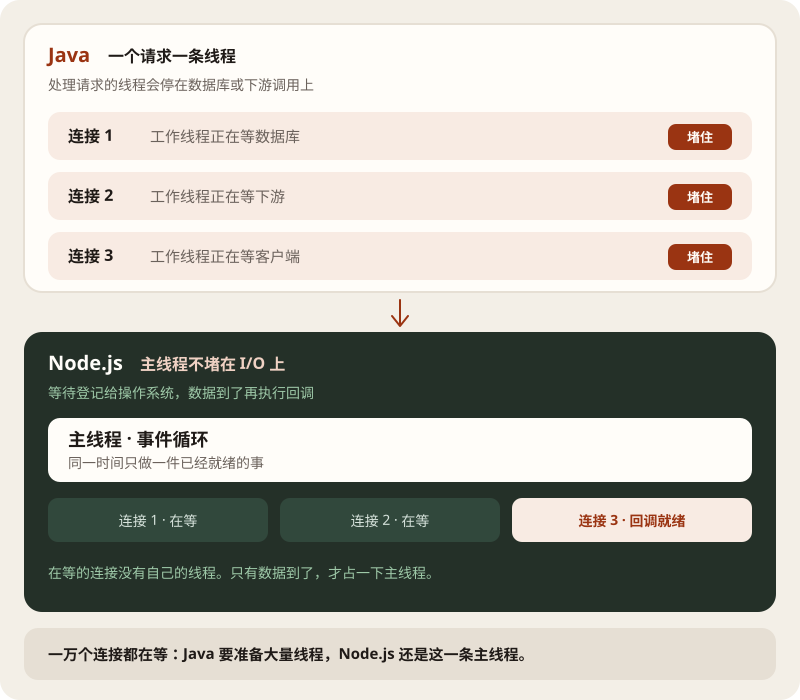
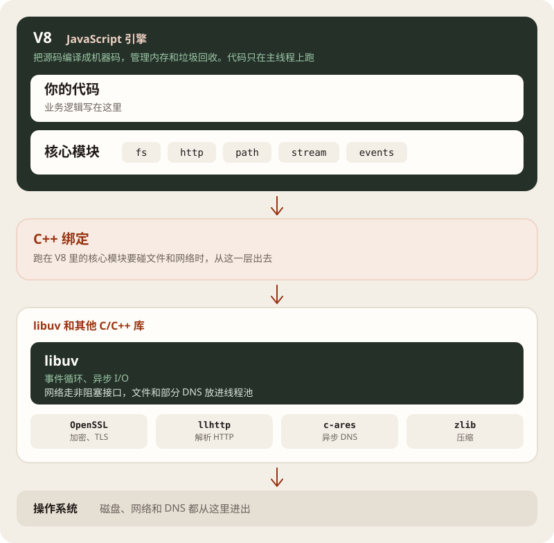
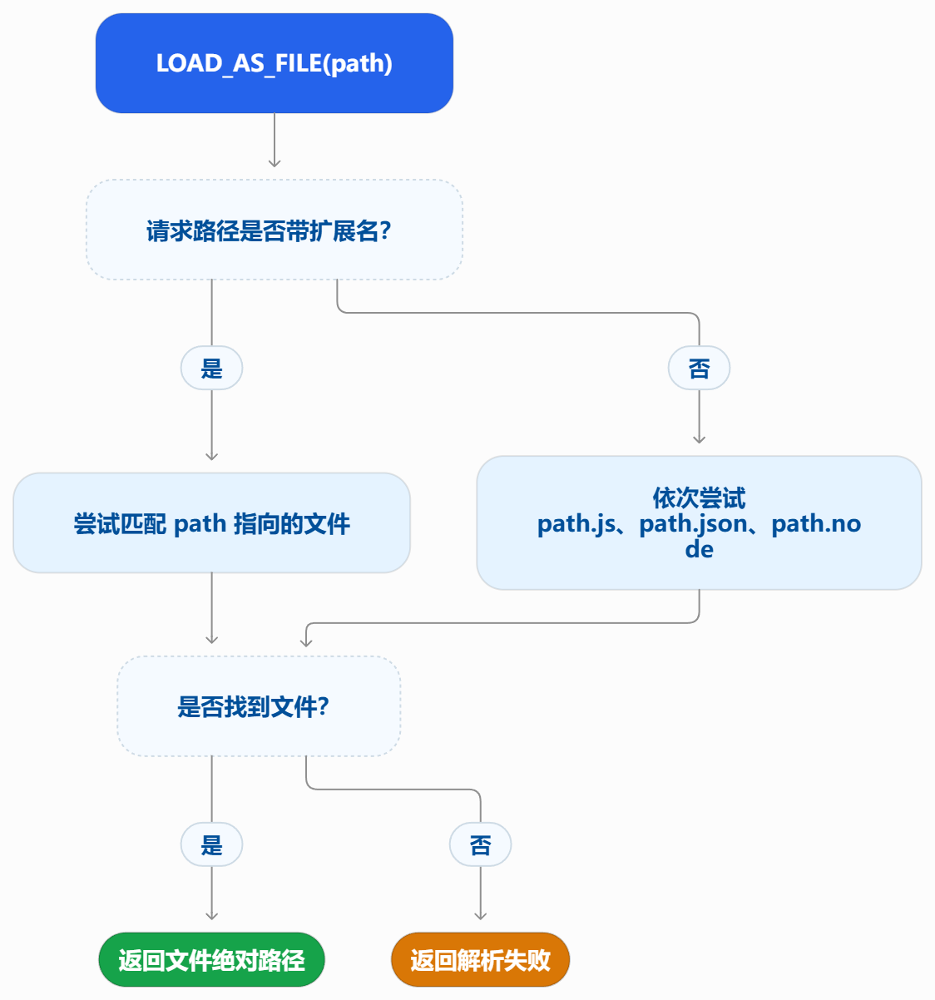
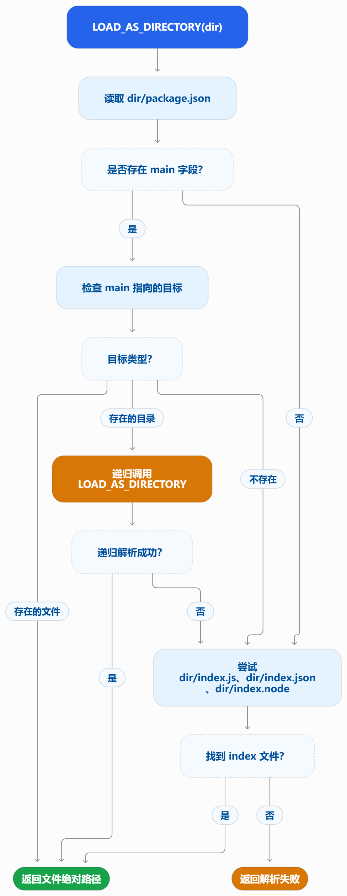
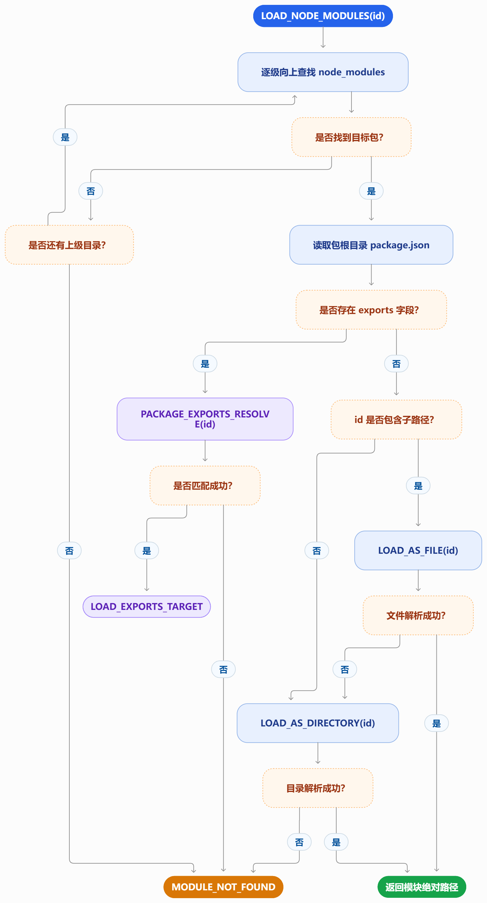
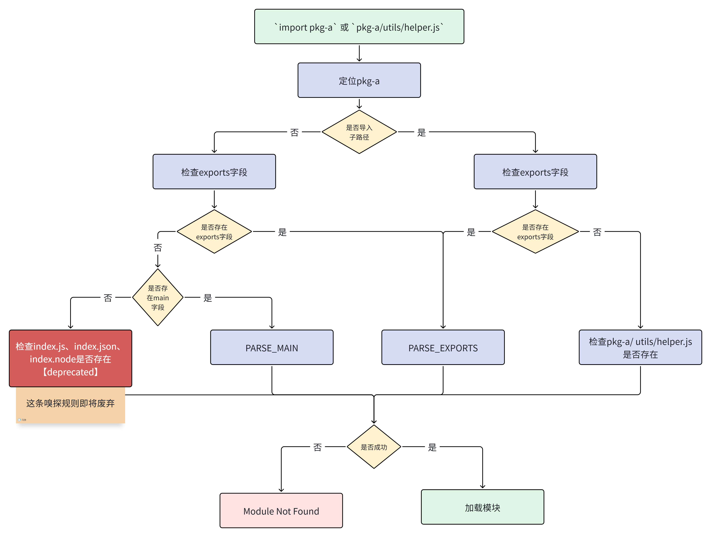

---

## title: Node.js 学习笔记

description: Node.js 的由来、维护发布、异步 I/O、CommonJS 与 ES Module，以及运行时架构。
date: 2026-11-11
tags:

- nodejs
- javascript
draft: false

## Node.js 简介

### 前世今生

Node.js 在 2009 年由 Ryan Dahl 发布。他想做一台能同时撑住很多连接的服务器，但当时常见的做法是一个连接占一个线程，线程又经常堵在磁盘和网络读写上。浏览器里的 JavaScript 已经是另一套模型：点一个按钮，回调稍后执行，页面不用停下来等。他把这套事件驱动搬到服务器上，并选用 Chrome 刚开源的 V8 来执行 JavaScript。语言本身还没有文件和网络接口，正好可以从头设计成非阻塞的。

项目做出名之后，云服务公司 Joyent 雇下 Ryan Dahl，出钱维护 Node.js，商标和发布也归 Joyent 管。2012 年 Ryan Dahl 离开，项目交给写了 npm 的 Isaac Schlueter，人仍然是 Joyent 的员工。

到了 2014 年，社区觉得 Joyent 把版本抓得太紧：发版慢，V8 升不上去，外面的贡献者进不了决策。一部分核心开发者分出 io.js，改由技术委员会公开决定，并跟上更新的 V8。两边并行了大约半年。2015 年 Joyent 和 io.js 谈妥，把商标和项目交给新成立的 Node.js 基金会（挂在 Linux 基金会下面），io.js 并回 Node.js，合并后的第一个版本是 4.0。2019 年 Node.js 基金会又和 JS 基金会合并，成为今天的 OpenJS 基金会。

### 维护与更新

改 Node.js 本身，途径是往 [nodejs/node](https://github.com/nodejs/node) 提一个 pull request。谁都可以提。协作者（Collaborator）负责审查和合并。技术指导委员会（TSC）拥有最终决定权，但只在意见谈不拢时介入，不会逐个补丁过会。

一个改动能合进去，要满足这几条：

- 至少两名协作者批准，作者自己不算。pull request 开了超过 7 天、又没有人反对时，一名协作者批准也可以。
- 不能有协作者明确反对。有人反对，这个改动就不能合。讨论或修改之后，反对可以撤回。
- 谈不拢时，给议题加上 `tsc-agenda`，放到 TSC 的会上。TSC 可以投票通过这个改动，即使还有人反对。

合进去之后进哪一条发布线，看它是否破坏现有行为。不兼容的改动只进下一条大版本。兼容的新功能进 Current，再由发布团队挑选、确认稳定之后，可以进 Active LTS。缺陷修复和安全更新会回移到还在维护的版本。

发布节奏从 Node.js 27 起改了。每年 10 月从 `main` 拉出下一条线，先发半年 Alpha，给库的作者和 CI 试用，不给生产环境用，这半年里允许不兼容的改动。次年 4 月发出第一个正式大版本，进入 Current，维持半年，只收兼容的改动。再下一个 10 月进入 LTS，之后 30 个月都处在 Active LTS，不再单设 Maintenance 阶段。从第一次 Current 算起，一条线大约维护 3 年。

26 以及更早的版本仍走旧节奏：大版本每半年一个。4 月的偶数版本才会进 LTS，先 Active 12 个月，再 Maintenance 18 个月。10 月的奇数版本不进 LTS。眼下的 Active LTS 是 26，生产环境用这一条。

JavaScript 语言本身的提案不走上面这套，那是 TC39 的阶段流程。这里说的是 Node.js 运行时和它的 API。发布日程记在 [nodejs/release](https://github.com/nodejs/release#release-schedule)。

### 异步 I/O

服务端要同时撑住很多连接，时间大多花在等待上：等数据库、等别的服务、等客户端把下一段数据发来。线程如果堵在这次等待里，就不能去处理别的连接。

Java 服务端最常见的做法，是一个请求分到一条线程。Servlet 和 Spring MVC 就是这样：连接可以由少量线程用 NIO 接住，请求真正开始处理时，会拿到线程池里的一条工作线程。代码走到 JDBC 或一次 HTTP 调用，这条线程就停在那里，直到对方回复。它停着的时候，不能去处理别的请求。同时在等的请求有一万个，就得有足够的线程接住。每条线程还带着自己的栈，在常见的 64 位虚拟机上大约 1MB，线程一多，内存和切换都跟着上去。

Node.js 的 JavaScript 只有主线程。网络读写不在这条线程上睡觉。核心模块通过 libuv 告诉操作系统：数据到了再通知我。主线程回去执行别的、已经就绪的回调。一万个连接都在等，占住主线程的只有那些此刻真正有事要做的回调。点击图片可以放大。



代价也在这条主线程上。回调如果去做很重的计算，事件循环就转不动，别的连接都要等它算完。所以 Node.js 适合大量连接、大部分时间在等 I/O，不适合用主线程做长时间的计算。

Java 后来也有别的做法。Netty 同样是事件循环。Java 21 的虚拟线程则换了一个方向：代码还可以按阻塞来写，等待时会让出底层的系统线程，于是不必再为每个正在等的请求准备一条操作系统线程。两边要解决的是同一件事，写法不一样。

### 整体架构

写出来的 JavaScript 不会直接碰到操作系统。这些代码跑在 V8 里；要碰文件和网络时，才经 C++ 绑定进到 libuv 和其他原生库。点击图片可以放大。



1. **V8**。Chrome 的 JavaScript 引擎。你的代码，以及 `fs`、`http`、`path` 这些核心模块，都在 V8 里执行。它把源码编译成机器码，并管理内存和垃圾回收。JavaScript 只在主线程上执行。
2. **C++ 绑定**。核心模块里需要系统能力的部分，通过这层去调下面的原生库。
3. **libuv 和其他 C/C++ 库**。libuv 跨平台，负责事件循环和异步 I/O。网络连接大多直接走操作系统的非阻塞接口；文件、部分 DNS 这类做不到真正非阻塞的操作，则放进 libuv 自己的线程池。旁边还有 OpenSSL（加密和 TLS）、llhttp（解析 HTTP）、c-ares（异步 DNS）和 zlib（压缩）。

一次 `readFile` 会走完这几层：JavaScript 调用核心模块，核心模块经绑定进入 libuv，libuv 在线程池里读完磁盘，事件循环再把结果交回 V8 里的回调。

## 模块化

### Package Scope

#### 1. 概念

Package Scope（包作用域）是 Node.js 根据 `package.json` 划分出来的一个模块配置作用范围。

Node.js 在判断一个 `.js` 文件应该按照 ESM 还是 CommonJS 加载时，会查找该文件最近的父级 `package.json`，并读取其中的 `type` 字段。

这个 `package.json` 所在的目录，就是对应的 Package Scope 的起点。

需要注意：

- Package 是包的组织概念。
- Package Scope 是 Node.js 用于确定模块配置的作用范围。
- 一个 Package 通常拥有自己的 Package Scope，但 Package Scope 不一定对应一个独立发布到 npm 的包。

#### 2. 如何划分 Package Scope

Node.js 以 `package.json` 为依据划分 Package Scope：

1. 一个目录中存在 `package.json`，就可以从该目录开始建立一个 Package Scope。
2. 该 Scope 覆盖当前目录及其子目录。
3. 如果子目录中又出现一个 `package.json`，则从这个子目录开始建立一个新的 Package Scope。
4. 向上查找父级 `package.json` 时，遇到 `node_modules` 目录或文件系统卷根目录就会停止。

例如：

```
project/
├── package.json              # Scope A
├── src/
│   ├── index.js              # 属于 Scope A
│   └── legacy/
│       ├── package.json      # Scope B
│       └── index.js          # 属于 Scope B
└── node_modules/
    └── bar.js                # ⭐没有package scope，只能是否语法检测判断模块化语法，或默认CommonJS
    └── lodash/
        ├── package.json      # Scope C
        └── index.js          # 属于 Scope C
```

这里：

- `project/` 是项目根目录，其 `package.json` 建立 Scope A。
- `src/` 没有自己的 `package.json`，因此属于 Scope A。
- `src/legacy/` 有自己的 `package.json`，因此建立 Scope B。
- `node_modules/lodash/` 有自己的 `package.json`，因此建立 Scope C。
- `node_modules/` 是向上查找 Package Scope 时的边界，不会继续继承 `project/package.json` 的配置。

#### 3. Package Scope 的作用

Package Scope 主要影响 Node.js 对模块的解释和解析行为。

**① 决定** `**.js**` **文件的模块类型**

通过 `package.json` 中的 `type` 字段：

```
{
  "type": "module"
}
```

- `"type": "module"`：Scope 内的 `.js` 文件按照 ESM 处理。
- `"type": "commonjs"`：Scope 内的 `.js` 文件按照 CommonJS 处理。
- 没有 `type` 字段：在当前启用语法嗅探的 Node.js 版本中，可能需要进一步进行 Syntax Detection；否则按照 CommonJS 处理。

`.mjs` 始终是 ESM，`.cjs` 始终是 CommonJS，不受 `type` 影响。

**② 决定** `**imports**` **字段的查找范围**

以 `#` 开头的包内部导入标识符，会在当前模块所属 Package Scope 的 `package.json` 中查找 `imports` 映射。

例如：

```
{
  "imports": {
    "#utils": "./src/utils.js"
  }
}
```

在该 Scope 内的模块可以使用：

```
import utils from '#utils';
```

如果子目录有自己的 `package.json`，那么它就属于新的 Scope，查找 `imports` 时也会使用新的 `package.json`。

**③ 参与包自引用（Self-referencing）**

如果 `package.json` 定义了 `name` 和 `exports`，当前包内部的模块可以通过包名引用自身公开的入口：

```
{
  "name": "my-package",
  "exports": {
    ".": "./index.js"
  }
}
import something from 'my-package';
```

#### 4. Package Scope 与 npm package 的区别

两者不是同一个概念。

| 对比                  | Package                      | Package Scope                      |
| --------------------- | ---------------------------- | ---------------------------------- |
| 核心含义              | 包的组织与分发单元           | 模块配置作用范围                   |
| 是否必须发布到 npm    | 不需要                       | 不涉及发布                         |
| 是否依赖 package.json | 通常以 package.json 描述     | 以 package.json、node_modules 划定 |
| 主要用途              | 组织代码、声明依赖、分发代码 | 决定模块类型及包内解析规则         |

例如：

```
project/
├── package.json
└── src/
    ├── index.js
    └── utils.js
```

`project/` 可以是一个 npm package，而 `src/` 只是其中的普通目录。它们并不是两个独立的 Package。

如果 `src/` 下再添加一个 `package.json`，那么它就会形成新的 Package Scope，但这并不意味着它自动成为一个独立的 npm package。

#### 5. 与 Package Scope 无关的事情

以下事情不能仅凭 Package Scope 来判断：

- **是否是一个 npm package**：取决于包的组织和发布方式，而不是是否形成了新的 Scope。
- **依赖关系**：`dependencies`、`devDependencies`、`peerDependencies` 等字段主要由 npm 等包管理器消费，不是 Package Scope 的划分依据。
- **是否可以被其他模块导入**：还需要考虑模块解析规则、`exports`、文件路径等。
- **是否是项目根目录**：Package Scope 可以嵌套在项目内部，不要求一定是项目根目录。

#### 6. 核心总结

Package Scope 可以理解为 Node.js 为模块文件划定的配置边界：

- `package.json` 建立 Scope。
- 子目录遇到新的 `package.json`，就建立新的 Scope。
- 向上查找时遇到 `node_modules` 或文件系统卷根目录就停止。
- `type` 决定 `.js` 文件的模块类型；`imports` 等字段则影响包内模块解析。

**记住：Package 是包的组织概念，Package Scope 是 Node.js 的模块配置作用范围。**


### Syntax Detection（语法嗅探）

#### 1. 概念

Syntax Detection 是 Node.js 用于判断模块类型的一种机制。

当 Node.js 无法通过文件扩展名或 `package.json` 中的 `type` 字段明确判断一个文件的模块类型时，会检查源代码中是否包含 ESM 专属语法。

- 检测到 ESM 语法：按照 ESM 加载。
- 没有检测到 ESM 语法：按照 CommonJS 加载。

它的作用是帮助 Node.js 处理模块类型不明确的 JavaScript 文件。

#### 2. 什么时候会触发

Syntax Detection 只针对模块类型不明确的输入。

主要包括：

**①** `**.js**` **文件**

文件满足以下条件：

- 扩展名为 `.js`。
- 没有能够控制该文件的 `package.json`，或者最近的 `package.json` 没有声明 `type` 字段。

例如：

```
project/
├── package.json
└── index.js
```

如果 `package.json` 没有 `type` 字段，那么 `index.js` 就属于模块类型不明确的输入。

**② 没有指定** `**--input-type**` **的字符串输入**

例如：

```
node --eval "console.log('hello')"
```

或者通过标准输入执行代码。

如果没有指定 `--input-type`，Node.js 也可能需要通过语法嗅探来判断模块类型。

#### 3. 不会触发的情况

以下情况不需要通过 Syntax Detection 判断模块类型：

**①** `**.mjs**` **文件**

```
// index.mjs
import fs from 'node:fs';
```

`.mjs` 扩展名明确表示 ESM。

**②** `**.cjs**` **文件**

```
// index.cjs
const fs = require('node:fs');
```

`.cjs` 扩展名明确表示 CommonJS。

**③** `**package.json**` **明确声明了** `**type**`

```
{
  "type": "module"
}
```

此时 Scope 内的 `.js` 文件按照 ESM 处理。

```
{
  "type": "commonjs"
}
```

此时 Scope 内的 `.js` 文件按照 CommonJS 处理。

#### 4. 如何判断 ESM 语法

Node.js 会检查源代码中是否存在能够明确表明它是 ESM 的语法。

主要包括：

| 语法                           | 示例                       |
| ------------------------------ | -------------------------- |
| 静态 import                    | `import fs from 'node:fs'` |
| 静态 export                    | `export const value = 1`   |
| import.meta                    | `import.meta.url`          |
| 顶层 await                     | `await fetch(url)`         |
| 顶层重新声明 CommonJS 包装变量 | `const require = ...`      |

最后一种情况需要特别注意：这里指的是在顶层使用词法声明重新声明 CommonJS 包装器中的变量，例如 `require`、`exports`、`module`、`__filename`、`__dirname`。

例如：

```
const require = 'something';

console.log(require);
```

在模块类型不明确的情况下，这种语法也会触发 ESM 判断。

**注意：动态 import() 本身不会触发 ESM 判断。**

例如：

```
import('./utils.js');
```

动态 `import()` 在 CommonJS 中同样合法，因此它不能单独作为判断 ESM 的依据。

#### 5. 判断流程

可以将 Syntax Detection 简化为以下流程：

```
              加载 JavaScript 文件
                       |
                       v
             判断文件扩展名
                       |
           +-----------+-----------+
           |                       |
         .mjs                    .cjs
           |                       |
           v                       v
          ESM                    CJS

           其他情况（如 .js）
                       |
                       v
    查找当前模块所属Package Scope的package.json
                       |
                       v
               是否声明 type？
                 /          \
               是            否
               |              |
               v              v
          根据 type       Syntax Detection
          判断类型             |
                       +-------+-------+
                       |               |
                   检测到 ESM      未检测到 ESM
                       |               |
                       v               v
                      ESM             CJS
```

其中，`type` 的查找范围遵循 Package Scope 的规则：向上查找最近的 `package.json`，遇到 `node_modules` 或文件系统卷根目录就停止。

#### 6. 版本与配置

Syntax Detection 的版本历史：

| Node.js 版本 | 变化     |
| ------------ | -------- |
| v20.10.0     | 引入     |
| v21.1.0      | 引入     |
| v20.19.0     | 默认启用 |
| v22.7.0      | 默认启用 |

当前官方文档将其标记为 **Stability 1.2 - Release candidate**。

可以通过以下命令关闭语法嗅探：

```
node --no-experimental-detect-module index.js
```

也可以通过 `NODE_OPTIONS` 传递该选项。

#### 7. 为什么需要 Syntax Detection

Node.js 历史上长期同时支持 CommonJS 和 ESM。

在没有明确声明模块类型的情况下，Node.js 需要一个默认处理方式。

Syntax Detection 提供了一种兼容机制：

- 如果代码明显使用 ESM 语法，就按照 ESM 处理。
- 如果没有发现 ESM 语法，就按照 CommonJS 处理。

但它并不能解决所有歧义。例如：

```
console.log('hello');
```

这段代码既可以是 CommonJS，也可以是 ESM，单纯从语法上无法判断作者的意图。

因此，语法嗅探只能处理存在明确 ESM 语法特征的情况。

#### 8. 最佳实践

尽量不要依赖 Syntax Detection 来决定模块类型。

推荐在 `package.json` 中显式声明：

```
{
  "type": "module"
}
```

或者：

```
{
  "type": "commonjs"
}
```

也可以通过 `.mjs` 和 `.cjs` 扩展名明确指定模块类型。

这样做有几个好处：

- 模块类型更加明确。
- 避免运行时进行额外的语法检测。
- 提高代码可读性。
- 让开发工具更容易判断模块类型。
- 避免 Node.js 默认行为未来发生变化带来的兼容性问题。

#### 9. 核心总结

Syntax Detection 是 Node.js 在模块类型不明确时，通过检查源代码语法来判断模块格式的机制。

可以记住：

- `.mjs` 和 `.cjs` 通过扩展名确定模块类型。
- `.js` 优先根据最近的 `package.json` 中的 `type` 判断。
- 没有明确的 `type` 时，可能触发 Syntax Detection。
- 检测到 ESM 专属语法则按照 ESM 加载，否则按照 CommonJS 加载。
- 最佳实践是显式声明 `type`，而不是依赖语法嗅探。


### CommonJS

**CommonJS** 是 Node.js 原来的模块格式。一个文件就是一个模块。文件里可以直接写 `require`、`exports`、`module`、`__filename`、`__dirname`，不用声明。


#### 基本语法

`require(id)` 同步加载一个模块，返回值是对方的 `module.exports`。`id` 可以是相对当前文件的路径、一个包名，或 `node:fs` 这种内置模块。相对路径相对的是当前文件，不是启动 Node 时的工作目录。

`exports` 和 `module.exports` 一开始是同一个对象。

```js
exports.a = 1;
// 等价于
module.exports.a = 1;
```

调用方拿到的是 `module.exports`。把它换成另一个值之后，`exports` 还指着旧对象：

```js
exports.a = 1;
module.exports = { b: 2 };
// require 拿到 { b: 2 }
```

只写 `exports = { b: 2 }` 也不会生效。`exports` 是参数，重新赋值只改了这个参数的指向，`module.exports` 仍是原来的空对象。

`__filename` 是当前文件的绝对路径，`__dirname` 是它所在的目录。

模块顶层的 `this` 指向一开始的那个 exports 对象。包装器调用这个函数时，把 `this` 设成了当时的 `module.exports`，所以刚进文件时 `this === exports`。之后如果执行了 `module.exports = ...`，`this` 和 `exports` 仍是旧对象，调用方拿到的是新值。

```js
console.log(this === exports); // true

exports.a = 1;
module.exports = { b: 2 };

console.log(this.a); // 1
console.log(this.b); // undefined
```

文件里自己写的函数，`this` 按普通 JavaScript 的调用规则来。顶层的箭头函数没有自己的 `this`，沿用模块这一层，也就是那个 exports。


#### 加载与执行

##### 支持的标识符

1. 核心模块。编译在 Node 的可执行文件里，不对应磁盘上的一个文件，所以不会去 `node_modules` 里找同名包。常用的有：
   - `node:fs`、`node:fs/promises`：读写文件
   - `node:path`：拼路径
   - `node:http`、`node:https`：HTTP 服务和请求
   - `node:events`：事件
   - `node:stream`：流
   - `node:os`：操作系统信息
   - `node:child_process`：拉起子进程
   - `node:crypto`：加密
   - `node:buffer`、`node:util`、`node:url`
   - `node:module`、`node:vm`：模块系统和脚本编译

     引入时写成 `node:fs` 这种形式。`fs` 这种旧写法，多数老模块还能用，但 `node:` 写明要的是内置模块。后加的一些模块只能带前缀，例如 `node:test`、`node:sqlite`。这样也不会在 Node 以后新增同名核心模块时，把原来的第三方包抢走。不是核心模块的，都按“文件路径”或“包路径”去解析。
2. 文件路径。绝对路径以 `/` 或盘符开头，相对路径以 `./` 或 `../` 开头。
3. 包路径。例如`foo`、 `foo/lib`


##### 解析模块标识符

核心模块：直接从Node可执行文件中导出，每个核心模块文件映射成一个唯一key。

文件路径：先尝试`LOAD_AS_FILE`，如果失败，则执行`LOAD_AS_DIRECTORY`

<p align="center">
  
  
</p>

包路径：先找到package，再进一步解析。




##### 模块缓存、符号链接

CommonJS 使用 `require.cache` 缓存已加载的模块，其缓存 Key 是模块解析完成后的文件名（Resolved Filename），通常是**绝对文件路径**。

**1. 缓存 Key 的路径形式**

不同操作系统的路径形式有所不同：

- 类 UNIX 系统（Linux / macOS）：使用 `/` 作为路径分隔符，以根目录 `/` 为起点。

```
/home/user/project/utils/helper.js
```

- Windows 系统：通常使用 `\` 作为路径分隔符，以盘符（如 `C:`）作为路径起点。

```
C:\Users\user\project\utils\helper.js
```

可以通过以下代码查看模块缓存：

```
console.log(Object.keys(require.cache));
```

**2. 符号链接（Symlink）与缓存 Key**

Node.js 默认会对模块路径进行 realpath 处理，即解析符号链接，获取其指向的真实文件路径。

例如：

```
project/
├── node_modules/
│   └── package-a -> ../../packages/package-a
└── packages/
    └── package-a/
        └── index.js
```

默认情况下，通过 `node_modules/package-a` 加载模块时，Node.js 会将符号链接解析为真实路径，缓存 Key 通常为：

```
/project/packages/package-a/index.js
```

因此，通过符号链接路径和真实路径加载同一个模块时，通常会命中同一个缓存条目。

可以通过以下启动参数改变这一行为：

```
node --preserve-symlinks index.js
```

启用后，Node.js 会保留符号链接路径，可能导致同一个物理文件对应多个不同的缓存 Key，从而产生多个模块实例。

**3. 缓存 Key 不等于物理文件的唯一身份**

CommonJS 根据解析后的文件名字符串进行缓存，而不是根据文件系统中的物理文件身份进行缓存。

例如，在 Windows 文件系统中（通常不区分大小写）：

```
const a = require('./utils/helper');
const b = require('./utils/HELPER');

console.log(a === b);
```

虽然两个路径可能指向同一个物理文件，但如果最终解析得到的文件名字符串不同，就可能产生不同的缓存条目。

**核心结论：**

- CommonJS 的模块缓存 Key 是解析后的文件名（Resolved Filename），通常是绝对路径。
- 默认情况下，Node.js 会解析符号链接，使用真实路径作为模块解析基础。
- `--preserve-symlinks` 可以保留符号链接路径，可能导致重复加载。
- 模块缓存依据的是路径字符串，而不是物理文件身份。


##### JS模块包装器

Node 不把JS文件当裸脚本执行。它先套一层包装器，再编译成函数：

```js
(function (exports, require, module, __filename, __dirname) {
  // 文件里的代码
});
```

所以这五个名字不用声明，文件里的变量和函数也不会漏到全局。

每个JS模块都被抽象成了一个Module实例，`module` 上常用的属性：

- `id`：模块标识。普通文件是绝对路径。入口文件被改成 `'.'`。
- `filename`：绝对路径。入口文件也是真实路径，不跟着 `id` 变成 `'.'`。
- `path`：文件所在目录，和 `__dirname` 相同。
- `exports`：`require` 拿到的值。新建时是 `{}`。
- `loaded`：是否执行完。执行过程中是 `false`。
- `children`：这个文件 `require` 过的模块对象。
- `paths`：从该文件所在目录开始，逐层向上的 `node_modules` 目录。`require` 一个包名时按这个列表找。
- `parent`：第一个 `require` 它的模块。已经弃用。一个文件可以被很多地方加载，这里只留第一次。
- `isPreloading`：是不是还在处理启动时预加载的模块。


##### 同步加载

同步指 `require` 要等这个模块准备好才继续。第一次遇到一个文件，Node 在主线程上把它读进来、编译、执行，然后才返回 `exports`。这期间事件循环处理不了别的回调。缓存里已经有的模块直接返回 `exports`，不再读文件，也不再编译。

主路径是：

1. 把 `id` 解析成绝对路径。按该文件的绝对路径作为key，进行缓存，缓存的是module对象。
2. 查 `Module._cache`，也就是 `require.cache`。模块已经执行完，直接返回它的 `exports`。
3. 没有就新建一个 `module`以`module.exports`对象，马上把`module`对象放进缓存。
   > 主路径上，是先创建并缓存`module`，再执行后面步骤（读文件内容、执行其模块代码），循环依赖靠的就是这第三步。因为如果在当前模块还没执行完时，当前模块依赖的其他模块又 `require` 回来时，缓存里已经有它`module`对象和导出内容，但 `loaded` 还是 `false`，拿到的是一份还没填完的 `exports`。
4. 读文件用同步的 `readFileSync`。
5. 源码套上包装器，编译成函数。公开接口是 `vm.compileFunction`：给它源码和参数名，它返回一个函数。Node 的加载器不走这个公开函数，而是调用底层的 `compileFunctionForCJSLoader`。效果一样，参数就是包装器上的那五个。
6. 调用这个函数。`this` 和第一个参数都是当时的 `module.exports`，后面依次是 `require`、`module`、文件路径、目录。
7. 执行完把 `module.loaded` 设为 `true`，`require` 返回 `module.exports`。中途抛错会把刚放进缓存的记录删掉，下次 `require` 会再试一次。

> 个人思考：每个新模块都要读文件再编译，所以不该出现在对时间敏感的执行过程里，比如服务器的 API 接口。Node 服务应该在冷启动时先加载必要的模块，再启动服务。

##### 包装器的实现原理

去掉缓存、路径解析和格式判断，包装器就是两步：同步读出源码，再编译成函数。`.js` 的加载核心是：

```js
const fs = require('node:fs');
const vm = require('node:vm');
const path = require('node:path');

Module._extensions['.js'] = function (module, filename) {
  const content = fs.readFileSync(filename, 'utf8');
  module._compile(content, filename);
};

Module.prototype._compile = function (content, filename) {
  // content 是函数体。compileFunction 在外面套上参数列表，
  // 得到的就是 (function (exports, require, module, __filename, __dirname) { ... })
  const compiledWrapper = vm.compileFunction(
    content,
    ['exports', 'require', 'module', '__filename', '__dirname'],
    { filename },
  );

  const dirname = path.dirname(filename);
  const exports = this.exports;
  compiledWrapper.call(exports, exports, require, this, filename, dirname);
  this.loaded = true;
  return exports;
};
```

`call` 的第一个参数是 `this`，后面五个依次对应包装器的参数。所以文件里的 `this`、`exports` 一开始都是 `module.exports`，`module` 就是当前这个实例，`__filename` 和 `__dirname` 来自文件路径。

`new Function` 也能做成同一个包装器。前面几个参数是形参名，最后一个是函数体：

```js
const compiledWrapper = new Function(
  'exports',
  'require',
  'module',
  '__filename',
  '__dirname',
  content,
);
```

`new Function` 和 `vm.compileFunction` 都是把文件内容当成函数体，在外面套上那五个参数。`vm.compileFunction` 还可以传入 `filename`，出错时堆栈能对上文件。

Node 源码里读文件同样是 `readFileSync(filename, 'utf8')`。编译不用这两个公开接口，而是 `compileFunctionForCJSLoader(content, filename)`。结果一样，走的是底层接口。每个 `require` 都要编译一次，公开接口每次都要检查参数、拼选项；底层接口参数固定为这五个，省掉这些步骤，并复用参数名。配了 `NODE_COMPILE_CACHE` 时，CommonJS 的编译缓存也在这里读写。


#### JSON模块和Node动态库

`.js` 走包装器。`.json` 和 `.node` 前面的解析和缓存相同，找到文件之后的处理不同。

**JSON 模块**

`require('./data.json')` 返回解析后的值，可以是对象、数组、字符串或数字。没有包装器，文件里不能写 `require`。

```js
Module._extensions['.json'] = function (module, filename) {
  const content = fs.readFileSync(filename, 'utf8');
  module.exports = JSON.parse(content);
};
```

Node 源码同样是 `readFileSync(filename, 'utf8')`。`JSON.parse` 之前会去掉文件开头的 UTF-8 BOM，再把结果直接设成 `module.exports`。解析失败时，错误信息前面加上文件名。读和解析都在主线程上，第一次加载会挡住事件循环。

**Node 动态库**

`.node` 是已经编译好的程序，不是 JavaScript 源文件。里面是 C++ 或 Rust 写的功能，扩展名用来让 `require` 认出它。Node 不会去读它的文本，也不会套包装器。加载之后，插件在 `exports` 上放好函数，用法和普通模块一样：

```js
const addon = require('./hello.node');
addon.hello();
```

`hello` 看起来是 JavaScript 函数。调用时 JavaScript 停在这一行，真正的计算在那份编译好的代码里跑，返回值再变回普通的字符串、数字或对象。

日常几乎不会自己写 `.node` 的路径。npm 包会再包一层 JavaScript，按你的系统选中对应的那一份，然后导出函数。你只 `require` 包名。Rspack 就是这样：业务代码调用 `@rspack/core`，解析和打包跑在它附带的 `.node` 里，那份文件由 Rust 编译而来。

这些函数属于这个包，不会变成 Node 自带的 `fs` 或 `http`。文件加载进进程之后会留在那里，下次 `require` 直接用缓存。它是给当前操作系统编译的，所以同一个包往往会为 Windows、macOS、Linux 各放一份，安装时选中你这台机器能用的那份。


------


### ES Module

ES Module 是 JavaScript 语言标准里的模块格式。一个文件就是一个模块。对外的值用 `export` 声明，依赖用 `import` 声明。文件是 `.mjs`，Node会按照ES Module的语法规则解析该模块，或者最近一层 `package.json` 写了 `"type": "module"` 时，`.js` 也按ES Module处理。

#### 基本语法

具名导出和默认导出：

```js
export const a = 1;

export function add(x, y) {
  return x + y;
}

export default function main() {
  return a;
}
```

对应的导入。相对路径相对当前文件，并且要带扩展名，写成 `./lib.js`。打包工具里经常可以省略扩展名，Node 里要写上。

```js
import main from './lib.js';
import { a, add } from './lib.js';
import { add as sum } from './lib.js';
import * as lib from './lib.js';
import './setup.js';
```

`import main from './lib.js'` 拿到默认导出。花括号里是具名导出，`as` 用来换一个本地名字。`import * as lib` 得到模块命名空间对象，`lib.add` 是对方 `add` 的活绑定，不是一份复制出来的普通对象。`import './setup.js'` 不取返回值，只执行那个文件。

从一个文件转出另一个文件的导出，常见于汇总入口：

```js
export { add } from './math.js';
export { default } from './main.js';
```

路径还有两种不必带扩展名的写法。包名写成 `import _ from 'lodash'`。内置模块写成 `import { readFile } from 'node:fs'`。

`import` 和 `export` 写在模块顶层，加载之前就能看出这个文件依赖谁。要在函数里或条件分支里加载，用 `import()`。它返回 Promise，结果上有具名导出和 `default`。模块顶层也可以直接 `await`。

```js
const lib = await import('./lib.js');
lib.add(1, 2);
lib.default();
```

导入拿到的是活绑定。对方模块里的变量后来变了，这里再读也是新值。这个名字在当前文件里不能重新赋值。

```js
// counter.js
export let n = 0;
export function inc() {
  n += 1;
}

// main.js
import { n, inc } from './counter.js';

inc();
console.log(n); // 1
```

`import.meta.url` 是当前文件的地址，形如 `file:///D:/app/main.js`。`import.meta.filename` 是绝对路径，`import.meta.dirname` 是它所在的目录。

模块顶层的 `this` 是 `undefined`。文件里自己写的函数，`this` 按普通 JavaScript 的调用规则来。


#### 加载与执行

ES Module 不是 CommonJS 那种“读到 `require` 时，马上执行另一个文件的包装函数”。

它先建立完整的模块依赖图，把图里的导入和导出连接起来，最后才执行模块顶层代码。

可以分成三个阶段：

1. **依赖图建立**

   a. Node.js宏的模块加载器从入口模块出发，首先将入口模块地址解析成一个URL，如`file://....`
2. **链接与绑定**：递归处理整张依赖图，创建模块作用域，把每个导入绑定连接到真正的导出绑定。
3. **求值（evaluate）**：依赖先执行，导入方后执行；一个模块只执行一次。

Node.js加载器主要负责依赖图建立部分的宿主工作，例如识别文件格式、解析包、读取文件和维护缓存。

V8 负责解析 ES Module 语法、创建模块记录、链接绑定和执行代码。

Node 源码把一次模块加载抽象成 `ModuleJob`，把交给 V8 的模块包装成 `ModuleWrap`。


##### 支持的标识符

1. **核心模块。** `node:fs`、`node:fs/promises` 这种 `node:` URL。后加的模块只有这一种写法，例如 `node:test`、`node:sqlite`。
2. **URL 标识符**。包括`file:` **和** `data:`**。** `file:///D:/app/main.js` 直接指向该文件。`data:text/javascript,...` 把源码写在 URL 里，没有对应的磁盘文件。`https:` 也能被认成 URL，默认到加载阶段会失败。
3. **文件模块。** 以 `/`、`./`、`../` 开头。说明符里还没有协议，相对当前模块 URL 解析之后才变成 `file:` URL。扩展名要写全，目录要写到具体文件，例如 `./lib/index.js`。Windows 上的 `D:/app/main.js` 会被当成协议 `d:`，要写成 `file:///D:/app/main.js`。
4. `#` **开头的标识符（子路径导入）。** 查当前包 `package.json` 的 `imports`。`#internal`、`#dep` 都是这种说明符。单独一个 `#` 无效。只有当前包内部的文件可以写这些名字。
5. **裸标识符（包路径）。** 其余说明符都归这里，例如 `lodash`、`lodash/get.js`、`@scope/pkg`。从当前模块所在目录向上找 `node_modules`，包有 `exports` 时按 `exports` 解析。不带前缀的老内置名也先到这里，`fs` 会被改写成 `node:fs` 再返回。


##### 解析模块标识符

1. 核心模块、URL标识符、文件模块的解析规则比较显而易见，只是要注意ESM模块解析不会自动补全扩展名进行嗅探。

2. `#`开头的标识符最后也会映射成核心模块、URL标识符、文件模块、裸标识符，只是要注意参考的`imports`字段是当前模块所属的Package Scope中的`package.json`。

3. 裸标识符的解析过程：

   


##### 模块缓存、模块 URL

ESM 使用 URL（Uniform Resource Locator）作为模块标识，并以解析后的模块 URL 作为模块缓存的依据。

与 CommonJS 使用文件绝对路径作为缓存 Key 不同，ESM 使用 URL 体系标识模块实例。

**1. 缓存 Key 的 URL 形式**

对于本地文件模块，Node.js 会将文件路径转换为 `file://` URL。

- 类 UNIX 系统（Linux / macOS）：

```
/home/user/project/utils/helper.js
```

对应：

```
file:///home/user/project/utils/helper.js
```

- Windows 系统：

```
C:\Users\user\project\utils\helper.js
```

对应：

```
file:///C:/Users/user/project/utils/helper.js
```

**2. 不同标识符映射到同一个 URL**

ESM 不会直接使用原始 import specifier 作为缓存 Key，而是先进行模块解析，得到最终 URL。

例如：

```js
// a.js
import './utils/helper.js';

// b.js
import 'file:///C:/Users/user/project/utils/helper.js';
```

如果两种导入方式最终解析得到相同的 URL：

```shell
file:///C:/Users/user/project/utils/helper.js
```

那么它们会复用同一个模块实例，模块代码只执行一次。

同理，不同 Package Scope 中的模块，即使使用不同的导入标识符，只要最终解析得到相同的模块 URL，也会复用同一个模块实例。

**3. Query 和 Fragment 会参与模块身份区分**

ESM 将 URL 作为模块标识，导入标识符可以带 query（`?`）和 fragment（`#`）。

找文件只用路径，`?` 和 `#` 留在解析后的 URL 上。

因此 URL 中的 Query 和 Fragment 也会影响模块缓存身份。

例如：

```js
import './helper.js?version=1';
import './helper.js?version=2';
```

虽然最终指向同一个物理文件，但由于 URL 不同，Node.js 会将它们视为不同的模块实例，分别加载和执行。

同样：

```js
import './helper.js#first';
import './helper.js#second';
```

也会产生不同的模块实例。

**4. 符号链接（Symlink）与模块 URL**

Node.js 默认会对模块路径进行 realpath 处理，即解析符号链接，使用真实文件路径作为模块解析的基础。

因此，通过符号链接路径和真实路径访问同一个模块时，默认情况下通常会归一到相同的模块 URL，从而复用同一个模块实例。

可以通过以下启动参数改变这一行为：

```shell
node --preserve-symlinks index.js
```

启用后，Node.js 会保留符号链接路径，可能导致同一个物理文件对应不同的模块 URL，从而产生多个模块实例。


**核心结论：**

- ESM 的模块缓存依据是解析后的模块 URL（Resolved URL）。
- 不同 import specifier 如果最终解析为相同 URL，会复用同一个模块实例。
- Query 和 Fragment 会参与模块身份区分，即使它们指向同一个物理文件，也可能产生不同模块实例。
- 默认情况下，Node.js 会解析符号链接；`--preserve-symlinks` 可以改变这一行为。
- ESM 的模块身份由 URL 决定，而不是由物理文件身份决定。


-------


##### 建立依赖图

Node 根据 URL 和格式取得源码，再让 V8 解析。解析时只分析语法、记录静态依赖，还不会运行顶层代码。因为静态 `import` 和 `export` 只能在顶层，V8 不执行模块就能知道它直接依赖哪些模块。

Node 为模块创建 `ModuleJob`，并按“模块 URL + 导入属性”查询加载缓存。第一次遇到就创建任务，之后遇到同一个模块复用任务。每个任务从 V8 的模块记录中取出依赖请求，再让加载器为这些依赖取得或创建任务，如此递归形成依赖图。

##### 链接和活绑定 ⭐

整张图加载完成后，V8 执行实例化。它为每个模块创建独立的模块环境，给 `let`、`const`、函数和类等声明建立绑定，再把导入方的名字直接连接到导出方的绑定。即`import { n } from './acounter.js'`绑定的是`counter.js`中`exports`的`n`属性。`counter.js` 中的 `n` 改变后，导入方读取同一个绑定，看到的就是新值。模块命名空间对象也只是这些导出绑定的只读视图。

因此下面的错误（`lib.js`并没有暴露`missing`这个属性），不会等到调用 `foo()` 才暴露，因为链接发生在执行之前，链接阶段就抛错，不会有任何代码执行。

```js
// main.js
import { missing } from './lib.js';
export function foo() {
  return missing;
}

// lib.js
console.log('this is lib.js');
export {};
```

⭐ 进一步理解活绑定：

下面的例子中，发生了模块的循环引用，即使`b.js`中访问`a.js`的`a`成员会发生运行时错误，原因是`a`在`b.js`执行时并没有初始化。由此可见，虽然运行时报错，但是`b.js`中的`a`变量成功绑定到了`a.js`中导出的`a`变量，**绑定是生效的**。

```javascript
// a.js
import { b } from './b.js'
export function funcA() {};
export const a = 'a';

// b.js
import { a, funcA } from './a.js';
funcA(); // 编译时、运行时都不会报错
console.log('a:', a); // 编译时不报错，运行时报错

export const b = 'b';
```

##### 执行顺序

链接成功后，V8 从入口沿依赖边深度优先求值。依赖模块先执行，依赖执行完成后才执行导入它的模块；同一个模块被多处导入，也只求值一次。

**例子一**

```js
// shared.js
console.log('shared');

// a.js
import './shared.js';
console.log('a');

// b.js
import './shared.js';
console.log('b');

// main.js
import './a.js';
import './b.js';
console.log('main');
```

输出为：

```text
shared
a
b
main
```

**例子二 **⭐

```js
// shared.js
console.log('shared');

// a.js
console.log('a start')
import './shared.js';
console.log('a end');

```

输出为：

```text
shared
a start
a end
```

#### ECMA Script 模块求值规则

##### 循环引用

ESM 允许循环引用，但处理方式不是像CommonJS一样把一个“还没填完的 `exports` 对象”提前交出去。

链接器会把循环中的模块作为一张图处理，先为所有模块创建绑定并连接好，再开始执行。

⭐绑定已经创建，不等于值已经初始化⭐

`let`、`const` 和 `class` 在声明执行前处于**暂时性死区**。如果循环中的模块过早读取它们，会抛出 `ReferenceError`：

```js
// a.js
import { b } from './b.js';
export const a = 'a';
console.log(b);

// b.js
import { a } from './a.js';
export const b = 'b';
console.log(a); // ReferenceError: Cannot access 'a' before initialization
```

入口加载 `a.js` 时，为了先执行它的依赖，V8 会先执行 `b.js`。此时 `a.js` 的环境和 `a` 绑定已经建立，但 `export const a = 'a'` 还没执行，所以读取失败。循环本身不一定报错；把读取延后到函数调用时，等双方都执行完再访问，通常就可以正常工作。

> CommonJS 循环依赖常见的现象是拿到部分初始化的 `module.exports`，属性可能是 `undefined` 或还不存在。ESM 拿到的是绑定：要么读到绑定当时的值，要么因为它还未初始化而明确报错。

当对一个依赖图进行求值时，会使用一个栈结构维护所有模块，父模块会等待子模块求值完毕，父模块的状态标志位会设置成`evaluating`，子模块求值时，如果发现循环依赖了父模块，子模块允许继续求值，只是如果访问了未初始化的变量会抛出运行时错误。

##### 顶层await

发生顶层await的模块会被标记为`evaluating-async`，任何一个其他模块如果依赖了一个`evaluating-async`的模块不允许被求值，必须等待。

```js
// main.js
import { b } from './b.js'; // ⭐ 依赖a，由于b依赖a，虽然b是main.js第一个依赖项，也会先对a求值
import { a } from './a.js'; // a存在顶层await，会中断求值
import { c } from './c.s'; // ⭐ 不依赖a

console.log('main start');
console.log('main end');

// a.js
console.log('a start');
await sleep(1000);
console.log('a end');
export const a = 'a';


// b.js
import { a } from './a.js';
console.log('b start');
export const b = 'b';
console.log('b end');

// c.js
console.log('c start');
console.log('c end');
export const c = 'c';

```

输出为：

```text
a start
c start
c end;
// 等待1000毫秒
a end
b start
b end
main start
main end;
```

##### 动态import

`import()` 在运行时才启动会对异步模块重新启动上述流程（建立依赖图、链接、求值），并总是返回 Promise：

```js
const namespace = await import('./feature.js');
```

1. 顶层 `await` 则会让模块的求值暂停。
2. 所有直接或间接依赖它的模块都要等待；
3. 不依赖它的其他分支仍可继续准备。
4. 等 Promise 完成后，该模块继续执行，随后它的导入方才能执行：

```js
// config.js
export const config = await readConfig();

// server.js
import { config } from './config.js';
startServer(config); // 一定在 readConfig() 完成之后
```


##### 动态import循环引用

`await import()` 会让当前模块进入 `evaluating-async`。这时再加载一个用静态 `import` 指回当前模块的文件，两条求值链就会互相等待。

```js
// main.js
export const value = 'main';
await import('./child.js');
console.log('main end');

// child.js
import { value } from './main.js';
console.log('child', value);
```

1. `main.js` 没有静态依赖，直接开始求值。`value` 初始化之后执行到 `await import('./child.js')`，模块进入 `evaluating-async`，停在这里等 Promise。
2. 加载器开始处理 `child.js`。它静态依赖 `main.js`，而 `main.js` 已经处于 `evaluating-async`。依赖这种模块的代码不能开始求值，只能等它求值结束。
3. `child.js` 等 `main.js`，`main.js` 又等 `child.js` 的 `import()`。谁都等不到谁。
4. `console.log('child', value)` 和 `main end` 都不会执行。`value` 虽然已经初始化，`child.js` 也读不到，因为它的求值还没开始。

这个 Promise 不会完成，也没有能用 `try/catch` 接住的异常。Node 发现进程中只剩下没有落地的顶层 `await` 时，打印 `Warning: Detected unsettled top-level await`，然后以退出码 13 结束。

##### “异步加载”

很多资料中说，ESM是“异步加载”，这应该需要说得更准确，对比`require()`和 `import()`：

- `import()` 的接口一定是异步的，模块求值也以 Promise 表示。
- 顶层 `await` 可以让整条依赖链真正暂停。
- 自定义异步加载钩子也可以异步解析或取得源码。
- 但没有顶层 `await` 的普通模块，其顶层语句仍在 JavaScript 主线程上按顺序执行，不会自动并行，也不会因为使用 ESM 就避免阻塞事件循环。
- 当前 Node 默认加载器在主线程上的普通解析、加载和链接路径可以同步完成；ESM 的核心区别是“先建图、链接，再求值”，而不是“读文件一定用了异步 I/O”。

Node 官方文档把默认解析和加载算法列在 [ECMAScript modules](https://nodejs.org/api/esm.html#resolution-and-loading-algorithm)，模块加载钩子列在 [Modules: Customization hooks](https://nodejs.org/api/module.html#customization-hooks)。实现入口可从 Node 源码中的 [`ModuleLoader`](https://github.com/nodejs/node/blob/main/lib/internal/modules/esm/loader.js) 和 [`ModuleJob`](https://github.com/nodejs/node/blob/main/lib/internal/modules/esm/module_job.js) 对照查看。


### 【WIP】解析exports


### 【WIP】CJS和ESM互操作

